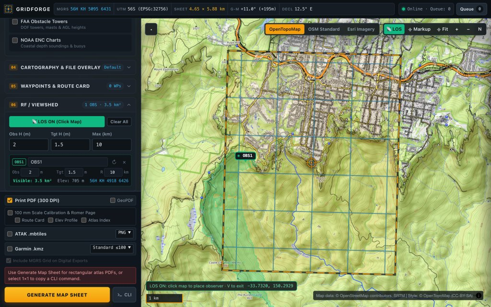
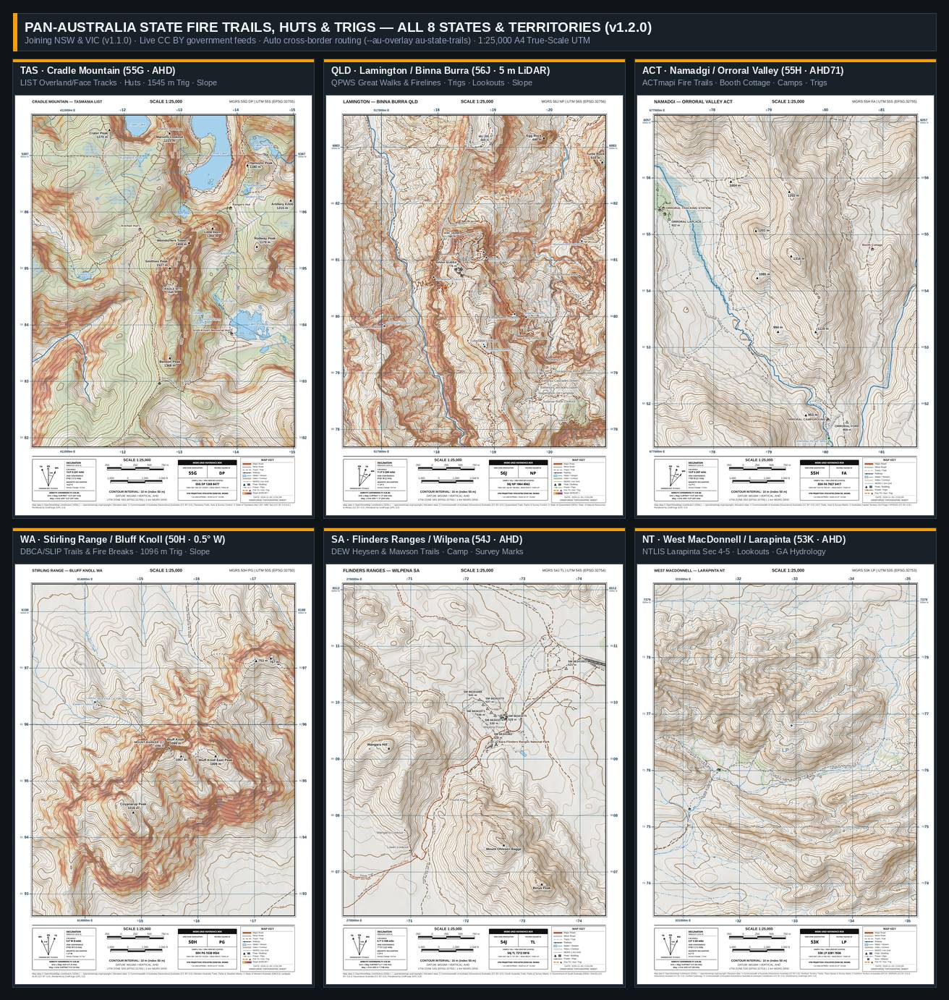
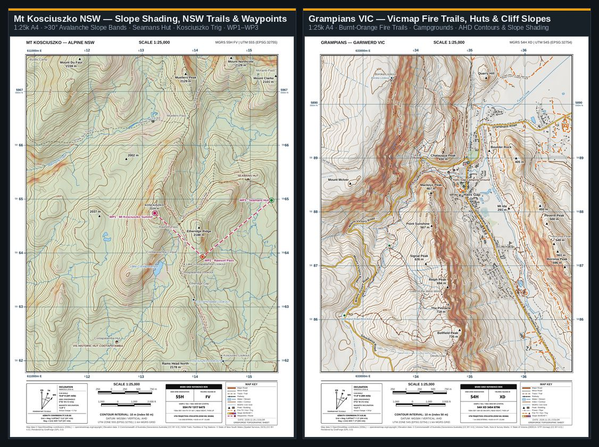

<div align="center">

# GridForge

**Open-source, self-hostable military-style MGRS topographic map generator, print studio & offline device exporter.**

[](LICENSE)
[](pyproject.toml)
[](Dockerfile)
[](https://github.com/jremick/gridforge/pkgs/container/gridforge)
[](tests/)
[](docker-compose.ghcr.yml)

True-scale **local UTM** 300 DPI print PDFs · **4 Themes (`Color`/`B&W`/`Night-Red`/`Alpine`)** · **RF Fresnel Link Cards & Viewsheds** · **US/Canada/AU/NZ Open Data** · **ATAK / Garmin / OsmAnd / GeoPackage / Field Bundle `.zip`**

</div>

---


## What Makes GridForge Different

| Capability | GridForge | Typical Web Tile / Screenshot Tools |
| :--- | :--- | :--- |
| **True Protractor Scale (Local UTM)** | Projects every sheet into its native local **UTM zone (`EPSG:326xx`/`327xx`)** — straight, orthogonal 1 km MGRS grid squares verified within **≤ 0.02 mm** (0.000 mm skew) with a physical map protractor. | Renders Web Mercator (`EPSG:3857`) where scale distorts with latitude and grid squares warp. |
| **Zero Multi-TB Mirroring + Air-Gapped Parity** | Streams **GA 5 m LiDAR / SRTM** (Australia), **USGS 3DEP 1 m LiDAR / 10 m** (US), and **Copernicus GLO-30** (global) + OSM on demand via GDAL `/vsicurl/`, OR runs 100% offline from a compact `--pack` via the exact same GeoPackage pipeline. | Requires downloading and maintaining multi-terabyte Planet/DEM mirrors upfront. |
| **Dedicated Laser-Print B&W Theme** | Hand-crafted high-contrast monochrome QGIS theme (diagonal forest hatches, stippled scrub, crisp cased roads, bright hillshade) engineered for black-and-white laser printers. | Post-process grayscale desaturation turns green forest + brown contours into illegible gray mud. |
| **Print + ATAK + Garmin From One Spec** | Generates 300 DPI vector print PDFs (single sheets or edge-matched `2×2`/`3×3` Atlas PDFs), **ATAK `.mbtiles`** (MBTiles 1.3 TMS), and **Garmin `.kmz`** (upright WGS84 baseline JPEGs respecting 100/500 tile caps) from identical cartography. | Separate disconnected tools with mismatched styling, bounds, and grids. |
| **16 GB Laptop / Homelab Friendly** | Zero Redis, SQLite WAL queue, `~124 MiB` combined idle RAM (`web` `64 MiB` + `worker` `60 MiB`), and ephemeral single-concurrency PyQGIS subprocesses (`~395 MB` typical job peak RSS). | Heavy multi-service stacks that leak memory or OOM on consumer hardware. |
| **100% Open & Cleanly Licensed Data** | GPL-3.0 code using strictly OpenStreetMap (ODbL), Geoscience Australia / DCCEEW CAPAD (CC BY 4.0), Copernicus DEM, USGS 3DEP / FEMA / NHD / FAA / NOAA (Public Domain), and NOAA WMM2025. | Proprietary basemaps, API keys, or restrictive map-server terms. |

---

## Visual Map Gallery

Every sheet below was generated directly by GridForge at 300 DPI and verified automatically by [`tests/integration/verify_pdf.py`](tests/integration/verify_pdf.py) for physical MediaBox dimensions, 1 km MGRS grid orthogonality, and exact scale accuracy.

| **Blue Mountains NSW — 1:25,000 A4 Color** (`EPSG:32756 · 56H`) | **Cradle Mountain TAS — 1:25,000 A4 Laser B&W** (`EPSG:32755 · 55G`) | **Boulder / Flatirons CO — 1:24,000 Letter Color** (`EPSG:32613 · 13T`) |
| :---: | :---: | :---: |
|  |  |  |
| *Copernicus / GA DEM, indexed contours, multi-directional hillshade, MGRS grid & WMM2025 collar* | *Dedicated B&W laser-print theme + GA Hydrology + CAPAD National Park boundaries (`AHD`)* | *USGS 3DEP 1 m LiDAR (`NAVD88`) + FEMA NFHL flood zones + NHD streams + FAA obstacle towers* |

| **Sydney Harbour NSW — 1:25,000 A4 Color** (`EPSG:32756 · 56H`) | **Uluru / Kata Tjuta NT — 1:25,000 A4 Color** (`EPSG:32752 · 52J`) | **Perth / Kings Park WA — 1:25,000 A4 Color** (`EPSG:32750 · 50J`) |
| :---: | :---: | :---: |
|  |  |  |
| *Native GA 5 m LiDAR (`AHD`) dense urban harbour & North Shore terrain* | *Outback UTM `52S` · GA SRTM 1s (`AHD`) + Outback bores/waterpoints + CAPAD NPC/IPA + airfields* | *Native GA 5 m LiDAR (`AHD`) · Swan River coastal guard + westerly G-M declination (`2.1° W`)* |

### 300 DPI Vector Detail & TC 3-25.26 Military Print Collar


### Offline Field Device Exports — ATAK `.mbtiles` & Garmin Custom Maps `.kmz`


---

## `v1.4.0` Alpine & Night-Red Themes, RF Fresnel Link Cards, North America Coverage & Field Bundles

GridForge `v1.4.0` expands into a complete multi-continent tactical & backcountry mapping platform across **North America (US & Canada)**, **Australia**, and **New Zealand**, adding four full cartographic themes (`172` native QGIS 3.40 `.qml` styles), curved-Earth RF Fresnel analysis, turnkey offline basemaps, Saved Trip Projects, and universal field-device bundles:


- **Point-to-Point RF / 1st Fresnel Link Profile & Link Card PDF (`--rf-link`, `--rf-link-card`, `⚡ A ↔ B` in Studio):** Models curved-Earth (`k=4/3`) terrain & 60% 1st Fresnel zone clearance across 200 DEM samples with band presets (`LoRa 915`, `UHF CB 477`, `GMRS 462`, `VHF 146`, `2.4/5.8 GHz`), FSPL (dB), WMM2025 Magnetic/Grid bearings + NATO mils, live inline SVG chart in Studio, and a pure-vector companion **RF Link Card** PDF page.
- **4 Dedicated Cartographic Themes (`--mode color|bw|night-red|alpine`, `172` Native `.qml`s):**
  - **`night-red`:** Red-headlamp-safe palette with zero red/orange ink (`R <= 61`) on critical terrain, roads, trails, water, grid, viewshed, and tactical markup so night operations stay razor-legible under red light.
  - **`alpine`:** Winter/ski-mountaineering palette featuring snow canvas, glacier polygons, Swiss glacier-blue contours, and boosted avalanche slope shading.
- **Strong North America Coverage (US & Canada):**
  - **United States (`--us-overlay us-trails`, `--us-overlay us-public-lands`):** Live Public Domain **USFS** & **NPS** trails/POIs plus **USGS PAD-US** & USFS federal land manager / wilderness boundaries layered over USGS 3DEP 1 m/10 m LiDAR (`NAVD88`).
  - **Canada (`--dem-source ca-hrdem`, `--ca-overlay ca-canvec-trails`):** Live OGL-Canada **NRCan CanElevation STAC** (`1 m / 2 m HRDEM` -> nationwide `mrdem-30` in `CGVD2013`) plus **Parks Canada** trails/POIs, **DataBC** trails, and **ECCC CPCAD** protected areas (integrated into 5-way `AutoDEMSource`).
- **Tactical Ruler, Concentric Range Rings & Sector AOIs (`--range-ring`, `--tactical-line`, `📏 Ruler` / `◎ Ring` / `⬠ Sector`):** Measure live geodesic distance, True/Grid/Magnetic azimuths, NATO mils, and DEM slope `%` grade in Studio, pin bearing lines, drop concentric range rings, and draw polygon sectors rendered crisply onto print sheets.
- **Turnkey Offline Basemaps (`gridforge basemap-pack`) & 29-Region Pack Manager:** Pure-GDAL hypsometric color-relief + hillshade `.mbtiles` (`< 300 MB` RAM) bundled automatically into packs across **29 global presets** (AU Tactical, AU States, New Zealand, North America) with per-pack Studio `/api/basemap/*?pack_id=` discovery.
- **GeoPackage Tiles, OsmAnd `.sqlitedb`, Field Bundle `.zip` & Saved Trip Projects (`--gpkg`, `--osmand`, `--field-bundle`):** Export atomic OGC GeoPackage raster tiles, OsmAnd `.sqlitedb` (`BigPlanet`), or an all-in-one `<slug>_field_bundle.zip` (PDF + device archives + GPX 1.1 + `README_FIELD_BUNDLE.txt`), and save/load/clone map setups with sheet thumbnails in the Studio **Projects** drawer.

```bash
# Yosemite Valley CA — Alpine Winter Theme + USGS 3DEP (NAVD88) + USFS/NPS Trails + PAD-US Public Lands
docker run --rm -v "$(pwd)/out:/out" ghcr.io/jremick/gridforge:latest \
  gridforge render --center "37.745,-119.593" --scale 24000 --paper letter --units imperial \
    --mode alpine --dem-source usgs3dep --us-overlay us-trails --us-overlay us-public-lands \
    --slope-shading --title "YOSEMITE VALLEY — ALPINE" \
    --output /out/yosemite_24k_letter_alpine.pdf

# Banff AB, Canada — Red-Headlamp Night-Red Theme + NRCan HRDEM/MRDEM (CGVD2013) + Parks Canada Trails
docker run --rm -v "$(pwd)/out:/out" ghcr.io/jremick/gridforge:latest \
  gridforge render --center "51.178,-115.571" --scale 25000 --paper a4 --mode night-red \
    --dem-source ca-hrdem --ca-overlay ca-canvec-trails \
    --title "BANFF — SULPHUR MTN (NIGHT-RED)" \
    --output /out/banff_25k_a4_night_red.pdf

# Mt Kosciuszko NSW — RF Viewshed + 915 MHz Fresnel Link Card + Tactical Rings + GeoPackage + OsmAnd + Field Bundle .zip
docker run --rm -v "$(pwd)/out:/out" ghcr.io/jremick/gridforge:latest \
  gridforge render --center "-36.456,148.263" --scale 25000 --paper a4 \
    --dem-source au-elvis --au-overlay au-nsw-trails \
    --viewshed "-36.4559,148.2636,10,1.5,8,Kosciuszko Relay" \
    --rf-link "-36.4559,148.2636,-36.4535,148.2877,10,2,915,Kosciuszko Relay,Seamans Hut" --rf-link-card \
    --range-ring "-36.4559,148.2636,1:2,Relay Rings" \
    --output /out/kosciuszko_rf_tactical.pdf --gpkg /out/kosciuszko.gpkg \
    --osmand /out/kosciuszko.sqlitedb --field-bundle /out/kosciuszko_field_bundle.zip

# Build a standalone pure-GDAL offline terrain basemap .mbtiles for air-gapped Studio use
docker run --rm -v "$(pwd)/packs:/data/packs" ghcr.io/jremick/gridforge:latest \
  gridforge basemap-pack --region blue-mountains --output /data/packs/basemap.mbtiles
```

---

## `v1.3.0` RF Viewsheds, New Zealand 1 m LiDAR, QLD 2 m LiDAR & Air-Gapped Studio

GridForge `v1.3.0` brings tactical radio/visual line-of-sight analysis, Trans-Tasman New Zealand support, Queensland Tier-0 2 m LiDAR, pure-vector Atlas Overview Index Covers & edge Fold/Join marks, a built-in Offline Pack Manager + Air-Gapped Web Basemap server, prebuilt multi-arch GHCR images, and local-first security & atomic-export hardening:




- **RF / Line-of-Sight Viewshed Mapping (`--viewshed`, Studio `📡 LOS` / `V` hotkey):** Runs multi-observer `gdal_viewshed` analysis directly on the sheet DEM, rendering emerald LOS coverage on the lower raster stack (preserving 100% vector contours, roads, and MGRS lines) with dashed range rings and `observer.svg` beacons (`10 m AGL`). Preview live visible coverage (`km²`) directly inside MapLibre Studio before printing.
- **New Zealand 1 m LiDAR / 8 m DEM (`NZVD2016`) & DOC Trails/Huts/Peaks (`--dem-source nz-linz`, `--nz-overlay nz-doc-trails`):** Streams zero-auth LERC COGs from AWS Open Data (`s3://nz-elevation`, 1 m LiDAR -> 8 m DEM -> Copernicus GLO-30) and overlays live CC BY 4.0 **DOC** Great Walks, alpine huts, campgrounds, and **LINZ** peaks (`AutoDEMSource` now routes US -> AU -> NZ -> Global automatically).
- **Queensland Tier-0 2 m State LiDAR (`--dem-source au-elvis`):** Automatically upgrades Queensland sheets inside completed `QldDem` projects to 2 m State LiDAR (`AHD`, CC BY 4.0) before falling through to GA National 5 m LiDAR and DEA SRTM 1 s.
- **Atlas Overview & Sheet Index Cover + Edge Fold/Join Marks (`--atlas-index`, `--fold-marks`):** Prepends a pure-vector schematic sheet index cover (`A1..C3` or `S1..Sn`, overlap hatching, route overlay, 10 m MGRS table) and adds `4.0 mm` corner crop & midpoint `FOLD / JOIN` registration marks outside the neatline.
- **Studio Offline Pack Manager & Air-Gapped Basemap Mode:** Build, inspect, and delete any of the 15 Australian offline packs directly from the Studio **Manage Packs** modal (`GET /api/packs/regions`, `POST /api/packs/build`), and mount a local raster `.mbtiles` (`GRIDFORGE_BASEMAP_MBTILES=/data/basemap.mbtiles`) to enable zero-external-request **Offline** Studio basemaps.

```bash
# Mt Kosciuszko NSW — RF/LOS Viewshed (10 m AGL Relay, 8 km) + Edge Fold/Join Marks
docker run --rm -v "$(pwd)/out:/out" gridforge:dev \
  gridforge render --center "-36.456,148.263" --scale 25000 --paper a4 \
    --dem-source au-elvis --au-overlay au-nsw-trails --fold-marks \
    --viewshed "-36.4559,148.2636,10,1.5,8,Kosciuszko Relay" \
    --title "MT KOSCIUSZKO — RF VIEWSHED" \
    --output /out/kosciuszko_viewshed_25k_a4.pdf

# New Zealand — Tongariro Alpine Crossing (LINZ 1 m LiDAR NZVD2016 + DOC Tracks/Huts + Slope Shading)
docker run --rm -v "$(pwd)/out:/out" gridforge:dev \
  gridforge render --center "-39.133,175.642" --scale 25000 --paper a4 \
    --dem-source nz-linz --nz-overlay nz-doc-trails --slope-shading \
    --title "TONGARIRO ALPINE CROSSING — NZ" \
    --output /out/tongariro_nz_25k_a4.pdf

# Bushwalk Strip Atlas + Pure-Vector Atlas Overview Index Cover + Elevation Profile + Fold Marks + Calibration
docker run --rm -v "$(pwd)/out:/out" -v "$(pwd)/examples:/examples:ro" gridforge:dev \
  gridforge render --strip-route /examples/katoomba_route.geojson --scale 25000 --paper a4 \
    --dem-source au-elvis --au-overlay au-state-trails \
    --atlas-index --elevation-profile --fold-marks --calibration-page \
    --title "KATOOMBA BUSHWALK STRIP ATLAS" \
    --output /out/katoomba_strip_atlas.pdf
```

---

## `v1.2.0` Pan-Australia State Trails, Huts & Trigs (All 8 States & Territories)

GridForge `v1.2.0` completes live open-government fire-trail, 4WD/walking track, backcountry hut, campground, and trig station coverage across **every Australian state and territory** (`NSW`, `VIC`, `TAS`, `QLD`, `WA`, `SA`, `NT`, `ACT`) — plus a single **`--au-overlay au-state-trails`** Auto router that seamlessly merges cross-border sheets and dynamically emits collar attributions only for contributing states.



| State / Mode | CLI Flag | Official Open-Data Agency & Datasets | License |
| :--- | :--- | :--- | :--- |
| **Auto (All 8 States)** | `--au-overlay au-state-trails` | Automatically routes & merges any intersecting states (e.g. NSW/ACT or NSW/VIC borders), bundles into offline `--pack`s, and credits only contributing states | **CC BY** (per-state) |
| **New South Wales** | `--au-overlay au-nsw-trails` | **NSW Spatial Services (DCS)** — `NSW_Transport_Theme` fire trails/tracks, `NSW_POI`, huts & `SurveyMarkGDA2020` trigs | **CC BY 4.0** |
| **Victoria** | `--au-overlay au-vic-trails` | **Victoria DEECA / DTP Vicmap WFS** — `tr_road` 4WD/fire access, `recweb_tracks`, `recweb_hut`, `recweb_site`, `geomark_point` | **CC BY 4.0** |
| **Tasmania** | `--au-overlay au-tas-trails` | **the LIST (NRE Tas)** — OpenDataWFS walking/Overland tracks, fire trails, alpine huts & TopographyAndRelief survey trigs | **CC BY 3.0 AU** |
| **Queensland** | `--au-overlay au-qld-trails` | **QSpatial (DESI / DNRM)** — QPWS Great Walks & firelines, RoadsAndTracks, tourist facilities, lookouts & FoundationData trigs | **CC BY 4.0** |
| **ACT** | `--au-overlay au-act-trails` | **ACTmapi / EPSDD** — Namadgi/Tidbinbilla fire trails, heritage walking tracks, huts, campgrounds & AHD71 survey marks | **CC BY 4.0** |
| **Western Australia** | `--au-overlay au-wa-trails` | **DBCA AGOL & Landgate SLIP** — Tracks/trails, fire breaks, RATIS sites/facilities, fire towers (`DBCA-061`) & geodetic marks (`LGATE-076`) *(strictly excludes CC BY-NC)* | **CC BY 4.0** |
| **South Australia** | `--au-overlay au-sa-trails` | **DEW / DHUD / Location SA + GA Topo250K** — Heysen & Mawson trails (low-RAM `/vsizip/` + spatial filter `< 20 MB` RSS), DEW fire tracks, parks & AHD marks | **CC BY 4.0** |
| **Northern Territory** | `--au-overlay au-nt-trails` | **NTLIS / DEPWS WFS 2.0 + NTG Roads + GA Topo250K** — Larapinta/4WD/unformed tracks, place names/lookouts & AHD survey control marks | **CC BY 4.0** |

```bash
# Automatic state routing anywhere in Australia (merges cross-border sheets & emits exact state attribution)
docker run --rm -v "$(pwd)/out:/out" gridforge:dev \
  gridforge render --center "-41.684,145.951" --scale 25000 --paper a4 \
    --dem-source au-elvis --au-overlay au-state-trails --slope-shading \
    --title "CRADLE MOUNTAIN — TASMANIA LIST" \
    --output /out/cradle_mountain_tas_trails_color.pdf

# Explicit per-state examples: QLD 5 m LiDAR Great Walks, SA Flinders Ranges (/vsizip/), NT West MacDonnell
docker run --rm -v "$(pwd)/out:/out" gridforge:dev \
  gridforge render --center "-28.200,153.190" --scale 25000 --paper a4 \
    --dem-source au-elvis --au-overlay au-qld-trails --slope-shading \
    --title "LAMINGTON — BINNA BURRA QLD" \
    --output /out/lamington_qld_trails_color.pdf

docker run --rm -v "$(pwd)/out:/out" gridforge:dev \
  gridforge render --center "-31.530,138.600" --scale 25000 --paper a4 \
    --dem-source au-elvis --au-overlay au-sa-trails \
    --title "FLINDERS RANGES — WILPENA SA" \
    --output /out/flinders_sa_trails_color.pdf
```

---

## `v1.1.0` Field Navigation & Alpine Tools

GridForge `v1.1.0` adds five backcountry planning and print-verification tools across both the MapLibre Print Studio UI and CLI:

- **Slope-Angle Avalanche Shading (`--slope-shading`):** Highlights steep `>30° / 35° / 45° / 50°+` alpine terrain on the bottom raster stack while keeping contours, trails, and MGRS lines 100% vector.
- **NSW & Victoria State Trail, Fire-Trail, Hut & Trig Overlays (`--au-overlay au-nsw-trails`, `--au-overlay au-vic-trails`):** Live CC BY 4.0 fire access trails, 4WD/walking tracks, alpine huts (*Seamans Hut*, *Cleve Cole Hut*), campgrounds, and AHD trig stations directly from **NSW Spatial Services** and **DEECA / Vicmap WFS**.
- **GPX / GeoJSON Auto-Strip-Map Builder & Elevation Profile (`--strip-route`, `--elevation-profile`):** Auto-fits minimum-count true-scale UTM strip sheets (`S1..Sn`) along any bushwalk track and generates a DEM-sampled Elevation Profile cover page.
- **Interactive Waypoint Markup & Tactical Route Card (`⌖ Markup` / `M` hotkey, `--waypoint`, `--route-card`):** Drop categorized waypoints (`WP`, `Camp`, `Water`, `Hazard`, `LZ`) directly on the map and print a companion Tactical Route Card with 10-digit MGRS, leg distances, and WMM2025 Grid/Magnetic azimuths (`°` & NATO `mils`).
- **100 mm Printer Scale Calibration & MGRS Romer Sheet (`--calibration-page`):** Appends an exact `100.00 mm` horizontal/vertical ruler (`0.000 mm` verified error), `4.00 in` bar, cut-out `1:24k / 1:25k / 1:50k` MGRS Romer corners, and `360° / 6400 mil` compass protractor ring.




```bash
# Mt Kosciuszko Alpine Sheet + Slope Shading + NSW Fire Trails/Huts/Trigs + Waypoints + Route Card + 100 mm Calibration
docker run --rm -v "$(pwd)/out:/out" gridforge:dev \
  gridforge render --center "-36.456,148.263" --scale 25000 --paper a4 \
    --dem-source au-elvis --au-overlay au-nsw-trails --slope-shading \
    --waypoint "Mt Kosciuszko Summit,-36.4559,148.2636,waypoint" \
    --waypoint "Rawson Pass,-36.4631,148.2736,hazard" \
    --waypoint "Seamans Hut,-36.4535,148.2877,camp" \
    --route-card --calibration-page --title "MT KOSCIUSZKO — ALPINE NSW" \
    --output /out/kosciuszko_25k_a4_alpine_color.pdf

# Auto-Fit Bushwalk Strip Atlas from GPX/GeoJSON + Elevation Profile + 100 mm Calibration Page
docker run --rm -v "$(pwd)/out:/out" -v "$(pwd)/examples:/examples:ro" gridforge:dev \
  gridforge render --strip-route /examples/katoomba_route.geojson --scale 25000 --paper a4 \
    --dem-source au-elvis --au-overlay au-nsw-trails --slope-shading \
    --elevation-profile --calibration-page --title "KATOOMBA BUSHWALK STRIP ATLAS" \
    --output /out/katoomba_strip_atlas.pdf
```

---

## 10-Second Self-Hosted Quickstart (Prebuilt GHCR or Source Build)

Run the full self-hosted **MapLibre GL JS Print Studio** and async render worker locally on Apple Silicon (`arm64`) or Linux (`amd64`).

### Option A — Zero-Build Prebuilt Image (`ghcr.io/jremick/gridforge:latest`)

```bash
git clone https://github.com/jremick/gridforge.git
cd gridforge
mkdir -p packs
docker compose -f docker-compose.ghcr.yml up -d
```

### Option B — Build Locally From Source

```bash
git clone https://github.com/jremick/gridforge.git
cd gridforge
docker compose up --build -d
```

> **Air-Gapped Web Basemap Mode:** Place any raster tile archive at `./basemap.mbtiles`, uncomment `GRIDFORGE_BASEMAP_MBTILES=/data/basemap.mbtiles` and `./basemap.mbtiles:/data/basemap.mbtiles:ro` in [`docker-compose.ghcr.yml`](docker-compose.ghcr.yml), and restart `web` — Studio automatically enables an **Offline** basemap switcher served locally from `/api/basemap/{z}/{x}/{y}.{format}`.

Open **<http://127.0.0.1:8080>** in your browser (`docker compose` binds IPv4 loopback `127.0.0.1:8080` by default and shares a single SQLite job queue; browser write requests must be same-origin):

- **Remote / Homelab Access:** Forward port `8080` over SSH (`ssh -L 8080:127.0.0.1:8080 user@host`), publish privately over [Tailscale Serve](deploy/tailscale-serve.md), or place GridForge behind an authenticated HTTPS reverse proxy ([Caddy](deploy/Caddyfile.example) / [Traefik](deploy/traefik-compose.override.yml)) that sets `GRIDFORGE_ALLOWED_HOSTS`, preserves the original `Host` header (including port), sets `X-Forwarded-Proto`, and configures `FORWARDED_ALLOW_IPS`.
- **Place Search & Direct Coordinates:** Press `/` to search any place name (via built-in Nominatim proxy), paste `lat,lon`, enter an MGRS coordinate (e.g. `56H KH 5100 6400`), jump to curated **NSW & Victoria outdoor presets** (*Blue Mountains, Mt Kosciuszko, Budawangs, Warrumbungles, Grampians, Wilsons Promontory, Mt Bogong, Cathedral Range*), or drag the crosshair reticle anywhere on the map.
- **Live Tilted UTM Footprint & MGRS Preview:** Visually inspects the exact true-scale UTM paper frame and 1 km MGRS grid lines (including convergence tilt) in real time; press `F` to fit the sheet to view. Sheets whose footprint or fetch margin crosses the antimeridian (`±180°`) are rejected with a clear validation error.
- **Multi-Sheet Edge-Matched Atlas PDFs:** Select `1×1`, `2×1`, `1×2`, `2×2`, `3×2`, or `3×3` in **Sheet & Print** to preview labeled adjacent sheets (`A1`–`C3`) sharing one locked UTM projection and export a merged multi-page true-scale Atlas PDF. Every atlas sheet center must stay in the anchor sheet's native UTM zone and hemisphere (validated by Studio before queueing).
- **Custom Overlays & Offline Packs:** Drag and drop `.geojson`, `.gpx`, or `.csv` files (try [`examples/katoomba_route.geojson`](examples/katoomba_route.geojson)), toggle Australian/US federal overlays, or pick any air-gapped pack placed in `./packs/` (Studio requires both DEM and OSM data in the selected pack).
- **Shareable Permalinks & Copy CLI:** Bookmark or share any map setup directly via URL parameters, click **Copy CLI** for a reproducible `docker compose run --rm cli gridforge ...` command (writing outputs to `./out/`, reading uploaded overlays/routes from `./out/inputs/`, resolving packs by manifest ID via `--pack-id` under `./packs/`, and directing unsupported rectangular atlas PDFs or strip+digital combos to **Generate Map Sheet**), and **Preview** or **Download** finished PDF / `.mbtiles` / `.kmz` artifacts from the Queue drawer.

Stop the stack cleanly anytime with `docker compose down`.

---

## CLI Cookbook & Air-Gapped Australia Pack Builder

Every studio capability is also available headlessly via the `gridforge` CLI (see [`examples/render-examples.sh`](examples/render-examples.sh) for a runnable end-to-end cookbook).

### Render a Print Sheet + Custom Route Overlay

```bash
mkdir -p out
docker run --rm -v "$(pwd)/out:/out" -v "$(pwd)/examples:/examples:ro" gridforge:dev \
  gridforge render \
    --center "-33.732,150.312" \
    --scale 25000 --paper a4 --mode color --units metric \
    --dem-source au-elvis \
    --overlay /examples/katoomba_route.geojson \
    --title "BLUE MOUNTAINS — KATOOMBA LOOP" \
    --output /out/katoomba_25k_a4_color.pdf \
    --mbtiles /out/katoomba_25k.mbtiles \
    --kmz /out/katoomba_25k.kmz
```

### Australia-Wide Cloud-Native Sheets (UTM `49S`–`56S`, `AHD`)

```bash
# Sydney Harbour — Native GA 5 m LiDAR (AHD)
docker run --rm -v "$(pwd)/out:/out" gridforge:dev \
  gridforge render --center "-33.8568,151.2153" --scale 25000 --paper a4 \
    --dem-source au-elvis --title "SYDNEY HARBOUR — NORTH SHORE" \
    --output /out/sydney_25k_a4_color.pdf

# Uluru / Kata Tjuta NT — Outback Bores, CAPAD National Parks/IPAs & Airfields
docker run --rm -v "$(pwd)/out:/out" gridforge:dev \
  gridforge render --center "-25.3444,131.0369" --scale 25000 --paper a4 \
    --dem-source au-elvis --au-overlay au-hydro --au-overlay au-parks --au-overlay au-aviation \
    --title "ULURU — KATA TJUTA NT" --output /out/uluru_25k_a4_color.pdf

# Cradle Mountain TAS — Dedicated Laser-Print B&W + ATAK + Garmin Exports
docker run --rm -v "$(pwd)/out:/out" gridforge:dev \
  gridforge render --center "-41.684,145.951" --scale 25000 --paper a4 --mode bw \
    --dem-source au-elvis --au-overlay au-hydro --au-overlay au-parks \
    --title "CRADLE MOUNTAIN — TASMANIA" \
    --output /out/cradle_mountain_25k_a4_bw.pdf \
    --mbtiles /out/cradle_mountain_25k.mbtiles --kmz /out/cradle_mountain_25k.kmz
```

### North America High-Res LiDAR + Federal Overlays (`NAVD88`)

```bash
docker run --rm -v "$(pwd)/out:/out" gridforge:dev \
  gridforge render --center "40.005,-105.285" --scale 24000 --paper letter --units imperial \
    --dem-source usgs3dep --us-overlay fema --us-overlay nhd --us-overlay towers \
    --title "BOULDER — FLATIRONS, CO" \
    --output /out/boulder_24k_letter_color.pdf \
    --mbtiles /out/boulder_24k.mbtiles --kmz /out/boulder_24k.kmz
```

### Air-Gapped Offline Packs (`gridforge pack`)

Build compact, self-contained regional packs streaming disk-to-disk at `< 300 MB` RAM across all 8 Australian states/territories (`act`, `tas`, `vic`, `nsw`, `sa`, `qld`, `nt`, `wa`), 7 curated tactical regions (`blue-mountains`, `sydney-basin`, `australian-alps`, `tasmania-wilderness`, `red-centre`, `perth-hills`, `far-north-qld`), or any custom `w,s,e,n` bounding box:

```bash
# List available Australian regions & estimated sizes
docker run --rm gridforge:dev gridforge pack list-regions

# Build a self-contained offline pack into ./packs/
mkdir -p packs
docker run --rm -v "$(pwd)/packs:/data/packs" gridforge:dev \
  gridforge pack build --region blue-mountains --output /data/packs/blue-mountains

# Render 100% air-gapped (zero network calls) using --pack (or --pack-id by manifest ID)
# Note: offline render/export require both DEM and OSM data; partial packs fail cleanly
# without falling back online unless completed with --offline-dem or --offline-pbf.
docker run --rm -v "$(pwd)/packs:/data/packs:ro" -v "$(pwd)/out:/out" gridforge:dev \
  gridforge render --center "-33.732,150.312" --scale 25000 --paper a4 \
    --pack /data/packs/blue-mountains --output /out/offline_sheet.pdf
```

### Standalone Offline Device Exports (`gridforge export`)

```bash
docker run --rm -v "$(pwd)/out:/out" gridforge:dev \
  gridforge export --center "-33.732,150.312" --scale 25000 --paper a4 \
    --format both --mbtiles-format png --garmin-profile standard --no-grid \
    --output /out/katoomba_offline
```

- **ATAK (Android):** Copy `<map>.mbtiles` into `atak/imagery/` and select it in ATAK's Maps / Imagery menu (`--mbtiles-format png` for crisp topo linework or `jpg` for smaller archives).
- **Garmin Handhelds:** Copy `<map>.kmz` into `Garmin/CustomMaps/` (`--garmin-profile standard` = 100-tile cap for classic eTrex/GPSMAP/Oregon; `modern` = 500-tile cap for GPSMAP 66/67, Montana 700, Oregon 7xx; or `--max-tiles N`).

---

## Measured Performance & Memory Profile

Measured on an Apple Silicon **M5 (16 GB RAM)** host running native `linux/arm64` Docker (`debian:trixie-slim`, PyQGIS `3.40.6`, GDAL `3.10.3`):

| Metric | Measured Result | Guardrail / Target |
| :--- | :--- | :--- |
| **`web` container idle RAM (`docker stats`)** | **`64.2 MiB`** (`65.0 MiB` post-render) | `< 250 MB` (`512m` hard limit; zero `qgis` imports) |
| **`worker` container idle RAM (`docker stats`)** | **`59.5 MiB`** | `< 200 MB` (`3g` hard limit; concurrency `1`) |
| **Typical render job peak RSS (`peak_rss_mb`)** | **`394.6 MB`** (A4 PDF + Garmin KMZ) | `< 2.0 GB` (ephemeral `spawn` PyQGIS subprocess) |
| **Warm-cache A4 300 DPI render time** | **`2.25 s`** (Katoomba B&W) / **`5.92 s`** (Boulder 1 m LiDAR) | Fast interactive turnaround |
| **1 km MGRS physical grid accuracy** | **`0.0046 mm`** (Letter 1:24k) / **`0.0185 mm`** (A4 1:25k) | `≤ 0.15 mm` protractor tolerance |
| **MGRS grid orthogonality skew** | **`0.0000 mm`** across all tested UTM zones | `< 0.05 mm` |
| **Automated test suite (`pytest` + Node)** | **`293` offline pytest + `6` Copy CLI unit tests passing** | Runs offline inside `gridforge:dev` & `npm --prefix web test` |
| **100 mm Calibration ruler accuracy** | **`0.0000 mm` error / `0.0000 mm` skew** (H & V) | `≤ 0.15 mm` |

---

## Architecture, Contributing & Testing

See **[CONTRIBUTING.md](CONTRIBUTING.md)** for development workflow and strict open-data licensing rules, **[docs/STYLING_GUIDE.md](docs/STYLING_GUIDE.md)** for customizing QGIS 3.40 `.qml` themes, and **`deploy/`** for homelab HTTPS reverse-proxy ([Caddy](deploy/Caddyfile.example), [Traefik](deploy/traefik-compose.override.yml)) and [Tailscale Serve](deploy/tailscale-serve.md) setups.

```text
src/gridforge/
├── config.py              # Pydantic v2 SheetSpec, RFLinkSpec, TacticalGraphic, ViewshedObserver contracts
├── cli.py                 # Typer CLI (`render`, `export`, `inspect`, `pack`, `basemap-pack`, `serve`)
├── geo/                   # UTM/MGRS CRS, atlas/antimeridian checks, tactical markup/ruler, RF Link Card & supplements
├── sources/               # US 3DEP/USFS/NPS/PAD-US, CA NRCan/Parks CA/DataBC, AU 2m/5m/8-states, NZ LINZ/DOC, GLO-30, OSM
├── packs/                 # 29-region global pack catalog, pure-GDAL offline basemap builder & manifest-ID lookup
├── pipeline/              # OSM -> GeoPackage normalization, GDAL hillshade/contours/slope/viewshed/Fresnel RF, runner
├── render/                # Isolated PyQGIS subprocess worker, 4-theme styling, QgsPrintLayout collar & fold marks
├── export/                # Atomic staged publication: ATAK MBTiles, Garmin KMZ, OGC GeoPackage, OsmAnd, Field Bundle .zip
└── web/                   # FastAPI server (zero qgis imports), SameOrigin/TrustedHost, Projects CRUD, Basemap & Pack Manager
web/                       # TypeScript + Vite + MapLibre GL JS Print Studio SPA + Copy CLI tests
config/osmconf.ini         # Shared GDAL OSM driver schema for online & air-gapped parity
assets/
├── icons/                 # 22 crisp self-contained military/topo/Outback/alpine/RF-observer SVG symbols
└── styles/{color,bw,night-red,alpine}/  # 172 native QGIS 3.40 .qml styles across 4 themes
deploy/                    # Caddyfile.example, Traefik v3 override, and Tailscale Serve homelab guide
.github/workflows/         # Automated offline CI + live multi-arch (amd64/arm64) GHCR release pipeline
examples/                  # Sample Blue Mountains GeoJSON route overlay & runnable CLI cookbook
```

```bash
# Offline unit + integration CI gate (no network required)
docker run --rm -v "$(pwd):/app" gridforge:dev pytest tests/unit tests/integration

# Web Studio Copy CLI unit & Compose parity tests
npm --prefix web test
npm --prefix web run test:compose

# Live multi-region Australia & North America E2E tests
docker run --rm -e GRIDFORGE_RUN_LIVE=1 -v "$(pwd):/app" gridforge:dev pytest tests/integration -m live
```

---

## Roadmap & Backlog

- **Shipped in `v1.4.0`:** Live multi-arch GHCR (`ghcr.io/jremick/gridforge:latest`), curved-Earth RF/Fresnel Link Profiles & Link Card PDFs, `night-red` & `alpine` themes (`172` native QGIS `.qml`s), Tactical Ruler/Rings/Sectors, turnkey pure-GDAL offline `.mbtiles` basemaps + 29 AU/NZ/NA pack regions, OGC GeoPackage `.gpkg` + OsmAnd `.sqlitedb` + Field Bundle `.zip`, Saved Trip Projects drawer, and full US (`us-trails`, `us-public-lands`) + Canada (`ca-hrdem`, `ca-canvec-trails`) coverage.
- **Shipped in `v1.3.0`:** GDAL RF/LOS Viewshed mapping (`--viewshed` & Studio `📡 LOS`), New Zealand LINZ 1 m LiDAR / 8 m DEM (`NZVD2016`) + DOC trails/huts/peaks, Queensland Tier-0 2 m State LiDAR, pure-vector Atlas Overview Index Covers & Fold/Join marks, Studio Offline Pack Manager & Air-Gapped MBTiles Web Basemap Mode, multi-arch GHCR CI/CD + homelab deploy guides, and local-first security/atomic-export/projection hardening (PRs `#1`–`#5`).
- **Shipped in `v1.2.0`:** Pan-Australia state fire-trail, hut, campground & trig coverage across all 8 states/territories (`NSW`, `VIC`, `TAS`, `QLD`, `WA`, `SA`, `NT`, `ACT`), automatic cross-border `au-state-trails` router with dynamic attribution, air-gapped pack bundling, and Studio Auto + 8-chip state selector.
- **Shipped in `v1.1.0`:** NSW & Victoria state fire-trail/hut/trig layers, GDAL slope-angle avalanche shading, GPX/GeoJSON auto-strip-map builder + elevation profile cover, interactive waypoint markup + tactical route cards, and 100 mm printer scale calibration & MGRS Romer pages.
- **Backlog (`v1.5+`):** European & UK open regional LiDAR providers (Swisstopo / IGN France / UK Environment Agency / Kartverket Norway), custom organization collar/legend branding profiles, and automated multi-sheet print-shop imposition (`A3`/`A2` booklet spreads).

---

## Data Sources, Attributions & License

| Dataset / Component | Scope & Vertical Datum | License & Attribution |
| :--- | :--- | :--- |
| **GridForge Source Code** | Application, styles, icons, web studio | **GNU GPL v3.0 or later** ([LICENSE](LICENSE)) |
| **OpenStreetMap** | Global roads, trails, rail, water, buildings, landcover, POIs | **ODbL** — Map data © OpenStreetMap contributors (`openstreetmap.org/copyright`) |
| **Geoscience Australia / DEA** | Australia 5 m LiDAR (2025) & SRTM 1s (`AHD`), Surface Hydrology, Electricity/Pipelines, Aviation/Homesteads, Topo250K tracks | **CC BY 4.0** — © Commonwealth of Australia (Geoscience Australia / Digital Earth Australia) |
| **Queensland QldDem LiDAR** | Queensland Tier-0 2 m State LiDAR (`AHD`, via `au-elvis`) | **CC BY 4.0** — © State of Queensland (Department of Resources) QldDem LiDAR |
| **Toitū Te Whenua LINZ** | New Zealand 1 m LiDAR & 8 m DEM (`NZVD2016`, AWS `s3://nz-elevation`, via `nz-linz`) & `NZ_Maunga` peaks | **CC BY 4.0** — Toitū Te Whenua Land Information New Zealand (LINZ) |
| **NZ Dept. of Conservation (DOC)** | New Zealand Great Walks, Tracks, Backcountry Huts & Campsites (`nz-doc-trails`) | **CC BY 4.0** — © Department of Conservation Te Papa Atawhai & Toitū Te Whenua LINZ |
| **DCCEEW CAPAD 2025** | Australia National Parks, Nature Reserves, IPAs | **CC BY 4.0** — © Commonwealth of Australia (DCCEEW) |
| **NSW Spatial Services (DCS)** | NSW Fire Trails, 4WD/Walking Tracks, Huts, Campgrounds & GDA2020 Trig Stations (`au-nsw-trails`) | **CC BY 4.0** — © State of New South Wales (Spatial Services, DCS) |
| **Victoria DEECA / DTP Vicmap** | Victoria 4WD/Fire Access Tracks, Walking Trails, Alpine Huts, Campgrounds & Survey Marks (`au-vic-trails`) | **CC BY 4.0** — © State of Victoria (DEECA / DTP Vicmap) |
| **Tasmania the LIST (NRE Tas)** | Tasmania Walking/Overland Tracks, Fire Trails, Huts & Survey Control (`au-tas-trails`) | **CC BY 3.0 AU** — © State of Tasmania (the LIST, NRE Tas) |
| **Queensland QSpatial (DESI / DNRM)** | Queensland QPWS Great Walks, Firelines, Parks Facilities & Survey Control (`au-qld-trails`) | **CC BY 4.0** — © State of Queensland (DESI / Dept. of Natural Resources & Mines) |
| **ACTmapi / EPSDD** | ACT Fire Trails, Walking Tracks, Huts, Campgrounds & AHD71 Survey Marks (`au-act-trails`) | **CC BY 4.0** — © Australian Capital Territory (ACTmapi / EPSDD) |
| **WA DBCA & Landgate SLIP** | Western Australia Trails, Fire Breaks, RATIS Parks/Facilities, Fire Towers & Geodetic Marks (`au-wa-trails`) | **CC BY 4.0** — © State of Western Australia (DBCA & Landgate SLIP) |
| **SA DEW / DHUD / Location SA** | South Australia Recreation Trails (Heysen/Mawson), Fire Tracks, Parks & Survey Marks (`au-sa-trails`) | **CC BY 4.0** — © Government of South Australia (DEW / DHUD) & Geoscience Australia |
| **NT NTLIS / DEPWS** | Northern Territory 4WD/Larapinta Tracks, Place Names/Lookouts & Survey Marks (`au-nt-trails`) | **CC BY 4.0** — © Northern Territory of Australia (NTLIS / DEPWS) & Geoscience Australia |
| **Copernicus WorldDEM-30** | Global 30 m elevation (`EGM2008`) | **Copernicus DEM License** — © DLR e.V. 2010–2014 & © Airbus Defence and Space GmbH 2014–2018, EU & ESA |
| **USGS 3DEP / NHD / FEMA / FAA / NOAA** | US 1 m & 10 m DEM (`NAVD88`), NHD streams, NFHL flood zones, DOF obstacle towers, ENC charts | **US Public Domain** |
| **USFS / NPS / USGS PAD-US** | US National Forest & National Park Trails/POIs (`us-trails`) and Federal Public Lands & Wilderness (`us-public-lands`) | **US Public Domain** — U.S. Forest Service, National Park Service & USGS PAD-US |
| **NRCan CanElevation (HRDEM / MRDEM)** | Canada 1 m / 2 m LiDAR & 30 m MRDEM (`CGVD2013`, via `ca-hrdem`) | **Open Government Licence – Canada** — Natural Resources Canada (NRCan) |
| **Parks Canada / DataBC / ECCC CPCAD** | Canada National Park Trails/POIs, BC Recreation Trails & Protected Areas (`ca-canvec-trails`) | **Open Government Licence – Canada / BC** — Parks Canada, ECCC CPCAD & DataBC |
| **NOAA / NCEI WMM2025** | Global magnetic declination & secular variation (`2025.0–2030.0`) | **US Public Domain** |
