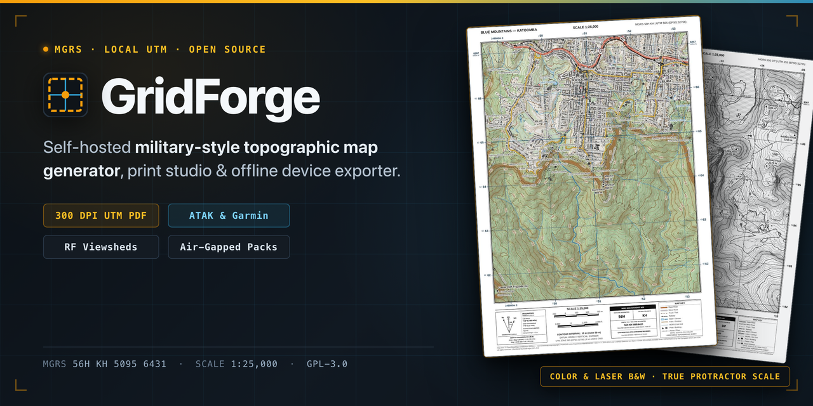
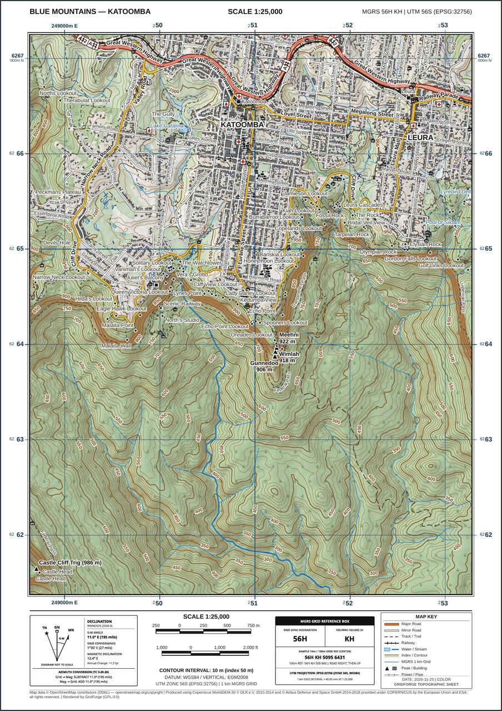
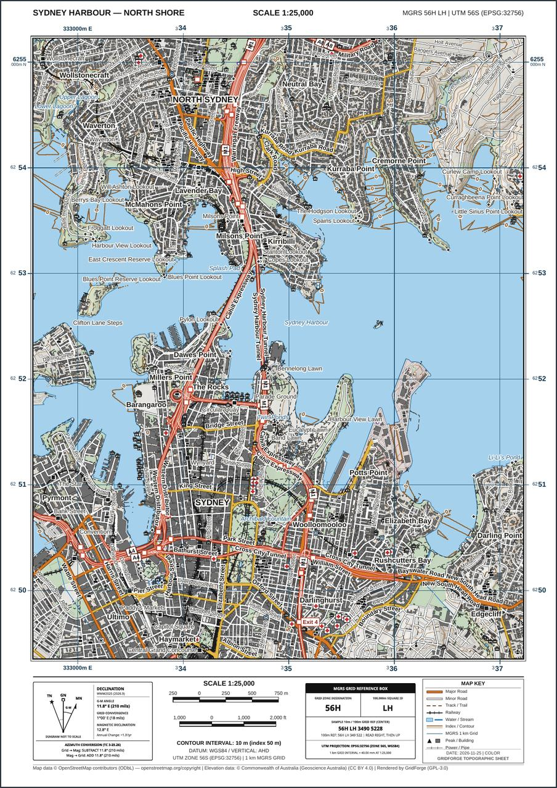
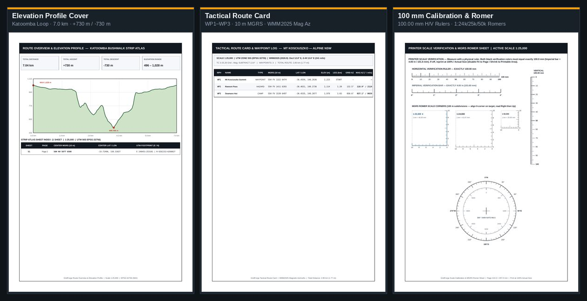
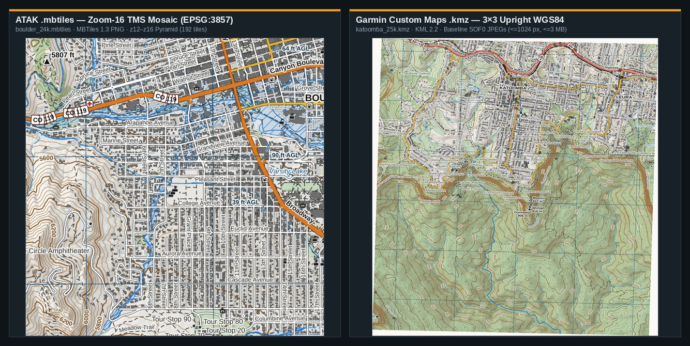
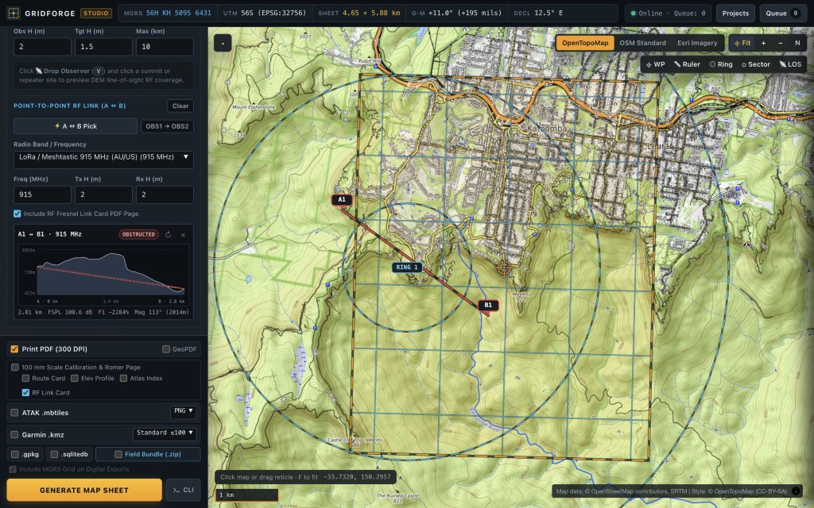

<div align="center">

<a href="docs/images/banner.png"></a>

# GridForge

**Open-source, self-hostable military-style MGRS topographic map generator, print studio & offline device exporter.**

[](https://github.com/jremick/gridforge/actions/workflows/ci.yml)
[](https://github.com/jremick/gridforge/actions/workflows/release.yml)
[](https://github.com/jremick/gridforge/releases/latest)
[](LICENSE)
[](Dockerfile)
[](https://github.com/jremick/gridforge/pkgs/container/gridforge)
[](tests/)
[](docker-compose.ghcr.yml)

True-scale **local UTM** 300 DPI print PDFs · **4 Themes (`Color` / `B&W` / `Night-Red` / `Alpine`)** · **RF Viewsheds & 1st Fresnel Link Cards** · **US, Canada, Australia & New Zealand Open Data** · **ATAK / Garmin / OsmAnd / GeoPackage / Field Bundle `.zip`**

[30-Second Quickstart](#30-second-self-hosted-quickstart) · [Sample 300 DPI PDFs](#visual-map-gallery--downloadable-300-dpi-pdfs) · [Capabilities](#capabilities) · [CLI Cookbook](#cli-cookbook) · [Homelab Deploy](#homelab--reverse-proxy-deployment) · [Changelog](CHANGELOG.md)

</div>

---

## 30-Second Self-Hosted Quickstart

Run the complete **MapLibre GL JS Print Studio** and async PyQGIS worker on **Apple Silicon (`arm64`)** or **Linux (`amd64`)** with zero local build time using the prebuilt multi-arch GHCR image:

```bash
git clone https://github.com/jremick/gridforge.git
cd gridforge
mkdir -p packs out
docker compose -f docker-compose.ghcr.yml up -d
```

Open **<http://127.0.0.1:8080>** in your browser (`127.0.0.1` loopback by default, `~150 MiB` combined idle RAM, no API keys required). Prefer building from source? Run `docker compose up --build -d`. Stop anytime with `docker compose down`.

<div align="center">
  
</div>

---

## What Makes GridForge Different

| Capability | GridForge | Typical Web Tile / Screenshot Tools |
| :--- | :--- | :--- |
| **True Protractor Scale (Local UTM)** | Projects every sheet into its native local **UTM zone (`EPSG:326xx`/`327xx`)** — straight, orthogonal 1 km MGRS grid squares verified within **≤ 0.02 mm** (`0.000 mm` skew) against a physical map protractor. | Renders Web Mercator (`EPSG:3857`) where scale distorts with latitude and grid squares warp. |
| **4 Purpose-Built Cartographic Themes** | `172` native QGIS 3.40 `.qml` styles across **Color**, **Laser B&W** (cross-hatched monochrome), **Night-Red** (zero red/orange ink for red headlamps), and **Alpine** (glacier-blue contours + avalanche slope bands). | Single web basemap or post-process grayscale that turns contours and trails into gray mud. |
| **Built-In RF Comms & Tactical Planning** | Multi-observer GDAL **RF Viewsheds**, curved-Earth ($k = 4/3$) **1st Fresnel Link Profiles** & printable **Link Card PDFs** (LoRa/Meshtastic, UHF, VHF), plus live **Ruler**, **Range Rings**, **Sector AOIs**, and **100 mm Romer Calibration** pages. | Disconnected RF tools, manual spreadsheet bearings, and zero print integration. |
| **Multi-Continent LiDAR + Turnkey Air-Gap** | Streams zero-auth **USGS 3DEP 1 m**, **Canada NRCan HRDEM 1 m/2 m**, **QLD 2 m / GA 5 m LiDAR**, **NZ LINZ 1 m LiDAR**, & **Copernicus GLO-30** on demand — or runs **100% offline** via **29 regional packs** with auto-generated offline terrain `.mbtiles` basemaps. | Multi-terabyte Planet/DEM mirroring upfront or internet-only cloud tile dependencies. |
| **One Spec → Print + Every Field Device** | Produces 300 DPI vector print PDFs / GeoPDFs (single sheets, `2×2`–`3×3` Atlases, GPX Strip Atlases), **ATAK `.mbtiles`**, **Garmin `.kmz`**, **OGC GeoPackage `.gpkg`**, **OsmAnd `.sqlitedb`**, and an all-in-one **Field Bundle `.zip`** (with GPX 1.1). | Separate disconnected exporters with mismatched bounds, datums, and grids. |
| **16 GB Laptop / Homelab Friendly** | Zero Redis, SQLite WAL queue + Saved Trip Projects, **`~150 MiB` combined idle RAM** (`web` `~77 MiB` + `worker` `~73 MiB`), local-first CSRF/Host hardening, and ephemeral PyQGIS subprocesses (`< 2 GB` peak RSS). | Heavy multi-service stacks that leak memory or OOM on consumer hardware. |
| **100% Open & Cleanly Licensed Data** | GPL-3.0 code using strictly OpenStreetMap (ODbL), US Public Domain (USGS/USFS/NPS/PAD-US/FEMA/FAA/NOAA), OGL-Canada (NRCan/Parks Canada/DataBC/ECCC), Australian Federal & 8-State CC BY, NZ LINZ/DOC CC BY 4.0, and NOAA WMM2025. | Proprietary basemaps, API keys, or restrictive `CC BY-NC` / commercial terms. |

---

## Visual Map Gallery & Downloadable 300 DPI PDFs

Every map below was rendered directly by GridForge at 300 DPI and verified automatically by [`tests/integration/verify_pdf.py`](tests/integration/verify_pdf.py) for exact MediaBox dimensions, 1 km MGRS orthogonality, and protractor scale accuracy.

### Download Real 300 DPI Sample Vector PDFs (`v1.4.0` Release)

Inspect true vector contours, crisp MGRS grid labels, military collars, and RF Fresnel charts directly in your PDF viewer — no Docker required:

| Sample PDF (Direct Download) | Region & Scale | Theme & Highlights |
| :--- | :--- | :--- |
| [**Yosemite Valley CA (`1:24,000` Letter)**](https://github.com/jremick/gridforge/releases/download/v1.4.0/sample-yosemite-alpine-24k-letter.pdf) | US · `11S KB` · `NAVD88` | **Alpine Winter** theme, USGS 3DEP 1 m LiDAR, USFS/NPS trails, PAD-US public lands & avalanche slope bands (`0.0046 mm` scale err) |
| [**Banff / Sulphur Mtn AB (`1:25,000` A4)**](https://github.com/jremick/gridforge/releases/download/v1.4.0/sample-banff-night-red-25k-a4.pdf) | Canada · `11U NS/PS` · `CGVD2013` | **Night-Red** (red-headlamp safe, zero red ink), NRCan HRDEM/MRDEM, Parks Canada trails, 100 km square boundary |
| [**Mt Kosciuszko NSW (`1:25,000` A4, 2 pages)**](https://github.com/jremick/gridforge/releases/download/v1.4.0/sample-kosciuszko-rf-tactical-25k-a4.pdf) | Australia · `55H FV` · `AHD` | **Color** + GDAL **RF Viewshed**, **915 MHz Curved-Earth 1st Fresnel Link Card (p. 2)**, concentric range rings & NSW trails |
| [**Tongariro Alpine Crossing (`1:25,000` A4)**](https://github.com/jremick/gridforge/releases/download/v1.4.0/sample-tongariro-nz-1m-lidar-25k-a4.pdf) | New Zealand · `60H UB` · `NZVD2016` | **Color** + live AWS **LINZ 1 m LiDAR**, DOC Great Walk tracks & alpine huts, LINZ peaks & slope shading |

### Multi-Continent Themes, RF Fresnel Cards, Viewsheds & Atlas Index Covers


### Classic Regional Sheets, 300 DPI Collar Detail & Offline Device Exports

| **Blue Mountains NSW — 1:25,000 A4 Color** (`56H`) | **Cradle Mountain TAS — 1:25,000 A4 Laser B&W** (`55G`) | **Boulder / Flatirons CO — 1:24,000 Letter Color** (`13T`) |
| :---: | :---: | :---: |
|  |  |  |
| *Indexed contours, multi-directional hillshade, MGRS grid & WMM2025 collar* | *Dedicated B&W laser-print theme + GA Hydrology + CAPAD boundaries (`AHD`)* | *USGS 3DEP 1 m LiDAR (`NAVD88`) + FEMA NFHL + NHD + FAA obstacle towers* |

| **Sydney Harbour NSW — 5 m LiDAR** (`56H`) | **Uluru / Kata Tjuta NT — Outback** (`52J`) | **Perth / Kings Park WA — 5 m LiDAR** (`50J`) |
| :---: | :---: | :---: |
|  |  |  |
| *Native GA 5 m LiDAR (`AHD`) dense urban harbour & North Shore terrain* | *Outback UTM `52S` · GA SRTM 1s + Outback bores + CAPAD + airfields* | *Native GA 5 m LiDAR (`AHD`) · Swan River coastal guard + `2.1° W` G-M* |






---

## Capabilities

### Self-Hosted MapLibre Print Studio



- **32 Curated Regional Quick-Jump Presets (`NSW/VIC` · `AU` · `NZ` · `NA`):** Defaults to 8 NSW & Victoria outdoor destinations with one-click region tabs for Australia-wide, New Zealand, and North America (US & Canada), plus `/` place search (Nominatim proxy), direct `lat,lon` / MGRS jump, and draggable crosshair reticle.
- **Live Tilted UTM Footprint & Multi-Sheet Atlas Validation:** Previews exact true-scale paper footprints, convergence tilt, and 1 km MGRS grid (`1×1` through `3×3`, `F` to fit). Rejects antimeridian (`±180°`) wraps and cross-zone/cross-hemisphere atlas layouts before queueing.
- **Saved Trip Projects & Sheet Thumbnails:** Persist named mission setups (coordinates, theme, overlays, waypoints, RF links, tactical graphics) in the topbar **Projects** drawer (`GET/POST/PATCH/DELETE /api/projects`) with lazy-cached PDF thumbnails (`GET /api/jobs/{id}/thumbnail.png`) for one-click reload or clone.
- **Shareable Permalinks & Safe Copy CLI:** Bookmark any configuration in URL parameters, or click **Copy CLI** for a POSIX-quoted `docker compose run --rm cli gridforge ...` command writing to `./out/`, resolving uploaded overlays from `./out/inputs/`, selecting packs by manifest ID (`--pack-id`), and warning without clobbering your clipboard for Studio-only multi-sheet combos.

### 4 Dedicated Cartographic Themes (`172` Native QGIS 3.40 `.qml` Styles)

- **`color` (Daytime Topo):** High-legibility military/backcountry topographic styling with multi-directional hillshade and vivid trail/hydro hierarchy.
- **`bw` (Laser Print Monochrome):** Explicit diagonal forest hatches, stippled scrub, crisp cased roads, and bright hillshade engineered specifically for black-and-white laser printers.
- **`night-red` (Red-Headlamp Safe):** Engineered with zero red/orange/brown ink (`R ≤ 61`) on critical contours, trails, roads, water, grid, viewshed, and tactical layers so nothing washes out under a 625–660 nm red headlamp.
- **`alpine` (Winter / Ski-Mountaineering):** Crisp snow canvas, glacier polygons, Swiss glacier-blue contours, and boosted avalanche slope-angle shading (`30° / 35° / 45°+`).

### RF Comms Planning (Viewsheds & Curved-Earth 1st Fresnel Link Cards)

- **Multi-Observer GDAL RF Viewsheds (`--viewshed`, Studio `📡 LOS` / `V`):** Computes terrain-masked line-of-sight coverage directly from the sheet DEM on the bottom raster stack (keeping all contours, trails, and MGRS lines 100% vector) with dashed range rings and `observer.svg` beacons.
- **Point-to-Point RF Link Profile & Link Card PDF (`--rf-link`, `--rf-link-card`, Studio `⚡ A ↔ B`):** Models curved-Earth ($k = 4/3$) bulge, 1st Fresnel zone ($r_1$) & 60% clearance across 200 DEM samples with band presets (`LoRa/Meshtastic 915/868 MHz`, `UHF CB 477 MHz`, `GMRS 462 MHz`, `VHF 146 MHz`, `2.4/5.8 GHz`), Free-Space Path Loss (dB), WMM2025 Magnetic/Grid bearings + NATO mils, live dark-mode SVG chart in Studio, and a pure-vector companion **RF Link Card PDF**.

### Field Navigation, Strip Atlases, Calibration & Tactical Markup

- **GPX / GeoJSON Auto-Strip-Map Builder & Supplements (`--strip-route`, `--atlas-index`, `--elevation-profile`, `--fold-marks`):** Auto-fits minimum-count true-scale UTM strip sheets along any track, prepends a pure-vector **Atlas Overview & Sheet Index Cover** (`A1..C3` or `S1..Sn` with overlap hatching & MGRS table) and **Elevation Profile**, and adds `4.0 mm` corner crop & `FOLD / JOIN` ticks outside the neatline.
- **100 mm Scale Calibration & MGRS Romer Sheet (`--calibration-page`):** Exact `100.00 mm` H/V verification rulers (`0.000 mm` error/skew), `4.00 in` bar, cut-out `1:24k / 1:25k / 1:50k` MGRS Romers, and `360° / 6400 mil` protractor.
- **Waypoints, Route Cards & Tactical Graphics (`⌖ WP`, `📏 Ruler`, `◎ Ring`, `⬠ Sector`):** Drop categorized waypoints (`WP`, `Camp`, `Water`, `Hazard`, `LZ`) for a printed **Tactical Route Card**, measure live geodesic distance + True/Grid/Mag azimuth + mils + slope `%` grade (`Pin to PDF`), drop concentric **Range Rings** (`--range-ring`), and draw hatched **Sector AOIs** rendered crisply onto 300 DPI PDFs.

### Air-Gapped Packs, Auto Offline Basemaps & Universal Field Device Exports

- **29 Curated Regional Packs (`gridforge pack` & Studio Manage Packs):** Build streaming `< 300 MB` RAM offline packs across **AU Tactical (7)**, **AU States (8)**, **New Zealand (6)**, **North America (8)**, or any custom BBox. Strict offline enforcement guarantees partial packs never silently fall back online unless explicitly completed with `--offline-dem` / `--offline-pbf`.
- **Turnkey Pure-GDAL Offline Basemaps (`gridforge basemap-pack`, `include_basemap=true`):** Generates hypsometric color-relief + hillshade `.mbtiles` automatically inside each pack (discovered via `/api/basemap/info?pack_id=` or `GRIDFORGE_BASEMAP_MBTILES=/data/basemap.mbtiles`) so Studio operates with **zero external internet requests**.
- **Atomic Offline Device Exports (`--mbtiles`, `--kmz`, `--gpkg`, `--osmand`, `--field-bundle`):** Same-filesystem atomic staging with SQLite sidecar protection across:
  - **ATAK `.mbtiles`** (MBTiles 1.3 TMS — copy to `atak/imagery/`)
  - **Garmin Custom Maps `.kmz`** (upright WGS84 JPEGs respecting 100/500 tile caps — copy to `Garmin/CustomMaps/`)
  - **OGC GeoPackage Raster Tiles `.gpkg`** (QField, Mergin Maps, ATAK, Locus Map, QGIS)
  - **OsmAnd `.sqlitedb`** (`BigPlanet` tile schema)
  - **All-in-One Field Bundle `.zip`** (all enabled PDF/device archives + valid **GPX 1.1** waypoints/markers + `README_FIELD_BUNDLE.txt`)

### Multi-Continent Open-Data Coverage (5-Way `AutoDEMSource`)

`AutoDEMSource` automatically routes every sheet to the highest-resolution zero-auth open elevation provider (`US → Canada → Australia → New Zealand → Global`) with native vertical datums on the collar:

- **United States (`usgs3dep`, `NAVD88`, Public Domain):** USGS 3DEP `1 m` LiDAR / `10 m` DEM + `us-trails` (USFS & NPS trails/POIs), `us-public-lands` (USGS PAD-US & USFS Wilderness boundaries), `fema` NFHL flood zones, `nhd` hydrography, `towers` FAA obstacles, and `enc` NOAA charts.
- **Canada (`ca-hrdem`, `CGVD2013`, OGL-Canada):** NRCan CanElevation STAC (`1 m / 2 m HRDEM` → nationwide `mrdem-30`) + `ca-canvec-trails` (Parks Canada trails/POIs, DataBC trails, and ECCC CPCAD protected areas).
- **New Zealand (`nz-linz`, `NZVD2016`, CC BY 4.0):** AWS Open Data `s3://nz-elevation` (`1 m` LiDAR → `8 m` DEM) + `nz-doc-trails` (DOC Great Walks, backcountry huts, campsites & LINZ peaks).
- **Australia (`au-elvis`, `AHD`, CC BY):** Tier-0 Queensland `2 m` State LiDAR → GA National `5 m` LiDAR → DEA SRTM 1 s, national overlays (`au-hydro`, `au-parks`, `au-infra`, `au-aviation`), plus all **8 States & Territories** via `--au-overlay au-state-trails`:

| State / Mode | CLI Flag | Official Open-Data Agency & Datasets | License |
| :--- | :--- | :--- | :--- |
| **Auto (All 8 States)** | `--au-overlay au-state-trails` | Automatically merges intersecting states (e.g. NSW/ACT or NSW/VIC borders), bundles into offline packs, and credits only contributing states | **CC BY** (per-state) |
| **New South Wales** | `--au-overlay au-nsw-trails` | **NSW Spatial Services (DCS)** — fire trails/tracks, POIs, huts & GDA2020 trigs | **CC BY 4.0** |
| **Victoria** | `--au-overlay au-vic-trails` | **Victoria DEECA / DTP Vicmap WFS** — 4WD/fire access, walking tracks, alpine huts & survey marks | **CC BY 4.0** |
| **Tasmania** | `--au-overlay au-tas-trails` | **the LIST (NRE Tas)** — Overland/walking tracks, fire trails, alpine huts & survey trigs | **CC BY 3.0 AU** |
| **Queensland** | `--au-overlay au-qld-trails` | **QSpatial (DESI / DNRM)** — QPWS Great Walks, firelines, parks facilities & survey control | **CC BY 4.0** |
| **ACT** | `--au-overlay au-act-trails` | **ACTmapi / EPSDD** — Namadgi/Tidbinbilla fire trails, tracks, huts & AHD71 survey marks | **CC BY 4.0** |
| **Western Australia** | `--au-overlay au-wa-trails` | **DBCA AGOL & Landgate SLIP** — tracks/trails, fire breaks, fire towers & geodetic marks *(excludes CC BY-NC)* | **CC BY 4.0** |
| **South Australia** | `--au-overlay au-sa-trails` | **DEW / DHUD / Location SA + GA Topo250K** — Heysen/Mawson trails (`/vsizip/` low-RAM), fire tracks & AHD marks | **CC BY 4.0** |
| **Northern Territory** | `--au-overlay au-nt-trails` | **NTLIS / DEPWS WFS + NTG Roads + GA Topo250K** — Larapinta/4WD tracks, lookouts & AHD survey marks | **CC BY 4.0** |

---

## CLI Cookbook

Every Studio capability runs headlessly via `ghcr.io/jremick/gridforge:latest` (see [`examples/render-examples.sh`](examples/render-examples.sh) for a runnable end-to-end script):

```bash
mkdir -p out packs

# 1. US Yosemite Valley CA — Alpine Winter Theme + USGS 3DEP (NAVD88) + USFS/NPS Trails + PAD-US Public Lands
docker run --rm -v "$(pwd)/out:/out" ghcr.io/jremick/gridforge:latest \
  gridforge render --center "37.745,-119.593" --scale 24000 --paper letter --units imperial \
    --mode alpine --dem-source usgs3dep --us-overlay us-trails --us-overlay us-public-lands \
    --slope-shading --title "YOSEMITE VALLEY — ALPINE CA" \
    --output /out/yosemite_24k_letter_alpine.pdf

# 2. Canada Banff AB — Red-Headlamp Night-Red Theme + NRCan HRDEM/MRDEM (CGVD2013) + Parks Canada Trails
docker run --rm -v "$(pwd)/out:/out" ghcr.io/jremick/gridforge:latest \
  gridforge render --center "51.178,-115.571" --scale 25000 --paper a4 --mode night-red \
    --dem-source ca-hrdem --ca-overlay ca-canvec-trails \
    --title "BANFF — SULPHUR MTN AB" \
    --output /out/banff_25k_a4_night_red.pdf

# 3. Australia Mt Kosciuszko NSW — RF Viewshed + 915 MHz Fresnel Link Card + Tactical Rings + Universal Field Bundle .zip
docker run --rm -v "$(pwd)/out:/out" ghcr.io/jremick/gridforge:latest \
  gridforge render --center "-36.456,148.263" --scale 25000 --paper a4 \
    --dem-source au-elvis --au-overlay au-nsw-trails \
    --viewshed "-36.4559,148.2636,10,1.5,8,Kosciuszko Relay" \
    --rf-link "-36.4559,148.2636,-36.4535,148.2877,915,10,5,Kosciuszko Relay,Seamans Hut" --rf-link-card \
    --range-ring "-36.4559,148.2636,1:2,Summit Rings" \
    --output /out/kosciuszko_rf_tactical.pdf --gpkg /out/kosciuszko.gpkg \
    --osmand /out/kosciuszko.sqlitedb --field-bundle /out/kosciuszko_field_bundle.zip

# 4. New Zealand Tongariro — Live LINZ 1 m LiDAR (NZVD2016) + DOC Great Walks/Huts + Slope Shading
docker run --rm -v "$(pwd)/out:/out" ghcr.io/jremick/gridforge:latest \
  gridforge render --center "-39.133,175.642" --scale 25000 --paper a4 \
    --dem-source nz-linz --nz-overlay nz-doc-trails --slope-shading \
    --title "TONGARIRO ALPINE CROSSING — NZ" \
    --output /out/tongariro_nz_25k_a4.pdf

# 5. Bushwalk Strip Atlas + Vector Index Cover + Elevation Profile + Fold Marks + 100 mm Calibration Sheet
docker run --rm -v "$(pwd)/out:/out" -v "$(pwd)/examples:/examples:ro" ghcr.io/jremick/gridforge:latest \
  gridforge render --strip-route /examples/katoomba_route.geojson --scale 25000 --paper a4 \
    --dem-source au-elvis --au-overlay au-state-trails \
    --atlas-index --elevation-profile --fold-marks --calibration-page \
    --title "KATOOMBA BUSHWALK STRIP ATLAS" \
    --output /out/katoomba_strip_atlas.pdf

# 6. Build a Turnkey Air-Gapped Regional Pack (with Offline Terrain Basemap .mbtiles) & Render 100% Offline
docker run --rm ghcr.io/jremick/gridforge:latest gridforge pack list-regions
docker run --rm -v "$(pwd)/packs:/data/packs" ghcr.io/jremick/gridforge:latest \
  gridforge pack build --region blue-mountains --output /data/packs/blue-mountains
docker run --rm -v "$(pwd)/packs:/data/packs:ro" -v "$(pwd)/out:/out" ghcr.io/jremick/gridforge:latest \
  gridforge render --center "-33.732,150.312" --scale 25000 --paper a4 \
    --pack-id blue-mountains --output /out/offline_sheet.pdf

# 7. Standalone Offline Terrain Basemap .mbtiles or Device-Only Exports (ATAK + Garmin)
docker run --rm -v "$(pwd)/packs:/data/packs" ghcr.io/jremick/gridforge:latest \
  gridforge basemap-pack --region blue-mountains --output /data/packs/basemap.mbtiles
docker run --rm -v "$(pwd)/out:/out" ghcr.io/jremick/gridforge:latest \
  gridforge export --center "-33.732,150.312" --scale 25000 --paper a4 \
    --format both --mbtiles-format png --garmin-profile standard --no-grid \
    --output /out/katoomba_offline
```

---

## Homelab & Reverse-Proxy Deployment

GridForge binds to IPv4 loopback (`127.0.0.1:8080`) by default, disables wildcard CORS, and enforces `TrustedHostMiddleware` + `SameOriginWritesMiddleware` on all mutating endpoints.

- **SSH Tunnel:** `ssh -L 8080:127.0.0.1:8080 user@homelab`
- **Private Tailnet:** See [deploy/tailscale-serve.md](deploy/tailscale-serve.md)
- **Authenticated HTTPS Reverse Proxy:** See [deploy/Caddyfile.example](deploy/Caddyfile.example) and [deploy/traefik-compose.override.yml](deploy/traefik-compose.override.yml) — set `GRIDFORGE_ALLOWED_HOSTS`, preserve original `Host` (with port), set `X-Forwarded-Proto`, and configure `FORWARDED_ALLOW_IPS`.
- **Air-Gapped Studio Basemap:** Building any regional pack with **Include Offline Basemap** automatically enables Studio's **Offline** basemap switcher via `/api/basemap/{z}/{x}/{y}.{ext}?pack_id=...`, or mount a global archive at `GRIDFORGE_BASEMAP_MBTILES=/data/basemap.mbtiles`.

---

## Measured Performance & Memory Profile

Measured across native `linux/arm64` & `linux/amd64` Docker (`debian:trixie-slim`, PyQGIS `3.40.6`, GDAL `3.10.3`):

| Metric | Measured Result | Guardrail / Target |
| :--- | :--- | :--- |
| **`web` container idle RAM (`docker stats`)** | **`77.0 MiB`** | `< 250 MB` (`512m` hard limit; zero `qgis` imports) |
| **`worker` container idle RAM (`docker stats`)** | **`72.9 MiB`** | `< 200 MB` (`3g` hard limit; concurrency `1`) |
| **Typical render job peak RSS (`peak_rss_mb`)** | **`394.6 MB`** (A4 PDF + KMZ) | `< 2.0 GB` (ephemeral `spawn` PyQGIS subprocess) |
| **Warm-cache A4 300 DPI render time** | **`2.25 s`** (Katoomba B&W) / **`5.92 s`** (Boulder 1 m LiDAR) | Fast interactive turnaround |
| **1 km MGRS physical grid accuracy** | **`0.0046 mm`** (Letter 1:24k) / **`0.0185 mm`** (A4 1:25k) | `≤ 0.15 mm` protractor tolerance |
| **MGRS grid orthogonality skew** | **`0.0000 mm`** across all tested UTM zones | `< 0.05 mm` |
| **100 mm Calibration ruler accuracy** | **`0.0000 mm` error / `0.0000 mm` skew** (H & V) | `≤ 0.15 mm` |
| **Automated CI suite (`pytest` + Node)** | **`293` offline pytest + `6` Copy CLI unit tests passing** | Runs offline in GitHub Actions CI & Docker |

---

## Architecture, Contributing & Testing

See **[CONTRIBUTING.md](CONTRIBUTING.md)** for development workflow and strict open-data licensing rules, **[docs/STYLING_GUIDE.md](docs/STYLING_GUIDE.md)** for authoring 4-theme QGIS 3.40 `.qml` styles, and **[docs/RELEASE_CHECKLIST.md](docs/RELEASE_CHECKLIST.md)** for the automated release & marketing preflight workflow.

```text
src/gridforge/
├── config.py              # Pydantic v2 SheetSpec, RFLinkSpec, TacticalGraphic, ViewshedObserver contracts
├── cli.py                 # Typer CLI (`render`, `export`, `inspect`, `pack`, `basemap-pack`, `serve`)
├── geo/                   # UTM/MGRS CRS, atlas/antimeridian checks, tactical markup/ruler, RF Link Card & supplements
├── sources/               # US 3DEP/USFS/NPS/PAD-US, CA NRCan/Parks CA/DataBC, AU 2m/5m/8-states, NZ LINZ/DOC, GLO-30, OSM
├── packs/                 # 29-region global pack catalog, pure-GDAL offline basemap builder & manifest-ID lookup
├── pipeline/              # OSM -> GeoPackage normalization, GDAL hillshade/contours/slope/viewshed/Fresnel RF, runner
├── render/                # Isolated PyQGIS subprocess worker, 4-theme styling, QgsPrintLayout collar & fold marks
├── export/                # Atomic staged publication: ATAK MBTiles, Garmin KMZ, OGC GeoPackage, OsmAnd, Field Bundle .zip
└── web/                   # FastAPI server (zero qgis imports), SameOrigin/TrustedHost, Projects CRUD, Basemap & Pack Manager
web/                       # TypeScript + Vite + MapLibre GL JS Print Studio SPA + Copy CLI tests
config/osmconf.ini         # Shared GDAL OSM driver schema for online & air-gapped parity
assets/
├── icons/                 # 22 crisp self-contained military/topo/Outback/alpine/RF-observer SVG symbols
└── styles/{color,bw,night-red,alpine}/  # 172 native QGIS 3.40 .qml styles across 4 themes
deploy/                    # Caddyfile.example, Traefik v3 override, and Tailscale Serve homelab guide
scripts/                   # release_preflight.py, render_release_samples.sh, sync_github_metadata.sh
.github/workflows/         # Automated offline CI + live multi-arch (amd64/arm64) GHCR release pipeline
examples/                  # Sample Blue Mountains GeoJSON route overlay & runnable CLI cookbook
```

```bash
# Build local dev image & run offline unit + integration CI gate (no network required)
docker build -t gridforge:dev .
docker run --rm -v "$(pwd):/app" gridforge:dev pytest -q tests/unit tests/integration

# Web Studio Copy CLI unit, Compose parity & release/README hygiene checks
npm --prefix web test
npm --prefix web run test:compose
python3 scripts/release_preflight.py

# Live multi-region North America, Australia & New Zealand E2E tests
docker run --rm -e GRIDFORGE_RUN_LIVE=1 -v "$(pwd):/app" gridforge:dev pytest -q tests/integration -m live
```

---

## Roadmap & Release History

See **[CHANGELOG.md](CHANGELOG.md)** and **[GitHub Releases](https://github.com/jremick/gridforge/releases)** for full per-version notes (`v1.0.0` through `v1.4.0`).

- **Planned Backlog (`v1.5+`):** European & UK open regional LiDAR providers (Swisstopo / IGN France / UK Environment Agency / Kartverket Norway), user-defined custom ArcGIS/WFS/GeoJSON overlay feeds in Studio, organization collar/legend branding profiles, and automated duplex folded booklet imposition (`A3`/`A2` print spreads).

---

## Data Sources, Attributions & License

| Dataset / Component | Scope & Vertical Datum | License & Attribution |
| :--- | :--- | :--- |
| **GridForge Source Code** | Application, styles, icons, web studio | **GNU GPL v3.0 or later** ([LICENSE](LICENSE)) |
| **OpenStreetMap** | Global roads, trails, rail, water, buildings, landcover, POIs | **ODbL** — Map data © OpenStreetMap contributors (`openstreetmap.org/copyright`) |
| **USGS 3DEP / NHD / FEMA / FAA / NOAA** | US 1 m & 10 m DEM (`NAVD88`), NHD streams, NFHL flood zones, DOF obstacle towers, ENC charts | **US Public Domain** |
| **USFS / NPS / USGS PAD-US** | US National Forest & National Park Trails/POIs (`us-trails`) and Federal Public Lands & Wilderness (`us-public-lands`) | **US Public Domain** — U.S. Forest Service, National Park Service & USGS PAD-US |
| **NRCan CanElevation (HRDEM / MRDEM)** | Canada 1 m / 2 m LiDAR & 30 m MRDEM (`CGVD2013`, via `ca-hrdem`) | **Open Government Licence – Canada** — Natural Resources Canada (NRCan) |
| **Parks Canada / DataBC / ECCC CPCAD** | Canada National Park Trails/POIs, BC Recreation Trails & Protected Areas (`ca-canvec-trails`) | **Open Government Licence – Canada / BC** — Parks Canada, ECCC CPCAD & DataBC |
| **Geoscience Australia / DEA** | Australia 5 m LiDAR (2025) & SRTM 1s (`AHD`), Surface Hydrology, Electricity/Pipelines, Aviation/Homesteads, Topo250K tracks | **CC BY 4.0** — © Commonwealth of Australia (Geoscience Australia / Digital Earth Australia) |
| **Queensland QldDem LiDAR** | Queensland Tier-0 2 m State LiDAR (`AHD`, via `au-elvis`) | **CC BY 4.0** — © State of Queensland (Department of Resources) QldDem LiDAR |
| **DCCEEW CAPAD 2025** | Australia National Parks, Nature Reserves, IPAs | **CC BY 4.0** — © Commonwealth of Australia (DCCEEW) |
| **Australian State & Territory Agencies** | Fire trails, walking tracks, alpine huts, campgrounds & survey trigs across NSW, VIC, TAS, QLD, ACT, WA, SA & NT (`au-state-trails`) | **CC BY 4.0 / CC BY 3.0 AU** — NSW Spatial Services, VIC DEECA/Vicmap, TAS the LIST, QLD QSpatial, ACTmapi, WA DBCA/Landgate, SA DEW/DHUD, NT NTLIS |
| **Toitū Te Whenua LINZ** | New Zealand 1 m LiDAR & 8 m DEM (`NZVD2016`, AWS `s3://nz-elevation`, via `nz-linz`) & `NZ_Maunga` peaks | **CC BY 4.0** — Toitū Te Whenua Land Information New Zealand (LINZ) |
| **NZ Dept. of Conservation (DOC)** | New Zealand Great Walks, Tracks, Backcountry Huts & Campsites (`nz-doc-trails`) | **CC BY 4.0** — © Department of Conservation Te Papa Atawhai & Toitū Te Whenua LINZ |
| **Copernicus WorldDEM-30** | Global 30 m elevation (`EGM2008`) | **Copernicus DEM License** — © DLR e.V. 2010–2014 & © Airbus Defence and Space GmbH 2014–2018, EU & ESA |
| **NOAA / NCEI WMM2025** | Global magnetic declination & secular variation (`2025.0–2030.0`) | **US Public Domain** |
