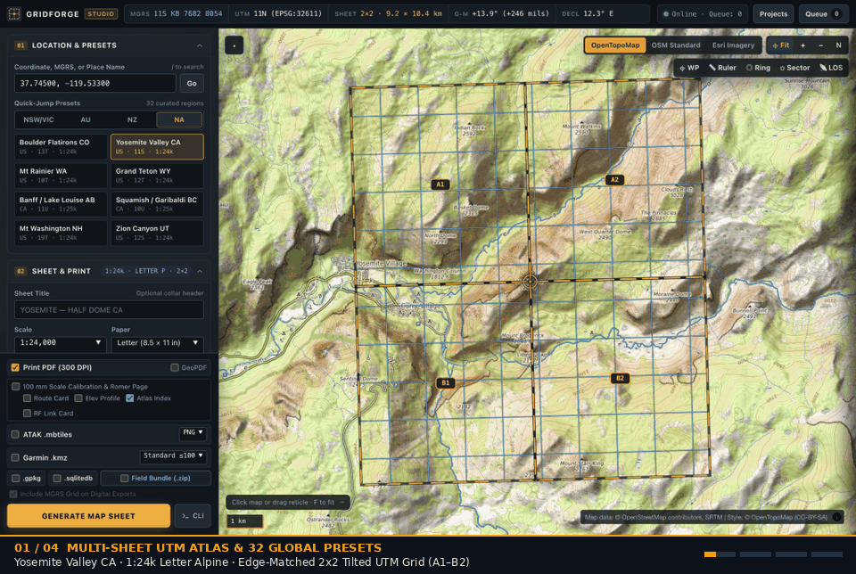
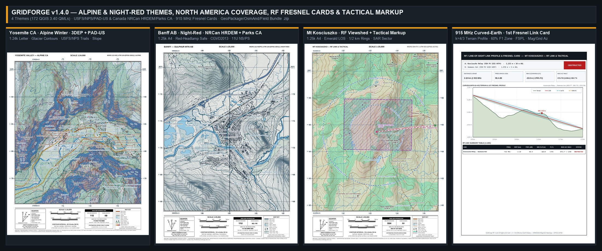

<div align="center">

<a href="docs/images/banner.png"></a>

# GridForge

**Open-source, self-hostable military-style MGRS topographic map generator, print studio & offline device exporter.**

[](https://gridmaps.net)
[](https://github.com/jremick/gridforge/actions/workflows/ci.yml)
[](https://github.com/jremick/gridforge/actions/workflows/release.yml)
[](https://github.com/jremick/gridforge/releases/latest)
[](LICENSE)
[](https://github.com/jremick/gridforge/pkgs/container/gridforge)

True-scale **local UTM** 300–600 DPI print PDFs (`1:10k`–`1:50k`) · **4 Cartography Themes** · **1 m LiDAR & RF Fresnel Planning** · **100% Offline Packs & ATAK/Garmin/OsmAnd/GeoPackage Exports**

**[Try GridMaps Live](https://gridmaps.net)** · [Quickstart](#quickstart) · [Sample PDFs](#sample-print-pdfs) · [Highlights](#highlights) · [AI & MCP](#ai-tools-mcp--interactive-chat-ui) · [CLI](#cli) · [Deployment](#deployment) · [Planned Roadmap](#planned-roadmap) · [Changelog](CHANGELOG.md)

</div>

---

## Quickstart

- **Try it live (no install):** **[GridMaps (`gridmaps.net`)](https://gridmaps.net)** is the official hosted GridForge Studio — preview live UTM footprints, WMM2025 declination, RF viewsheds & Fresnel link profiles, and generate free single-sheet 300 DPI demo PDFs.
- **Self-host in 30 seconds (`arm64` & `amd64`):** Unlimited multi-sheet atlases, device exports, and 29 offline regional packs — zero API keys, `~150 MiB` idle RAM, `127.0.0.1` loopback by default:

```bash
git clone https://github.com/jremick/gridforge.git && cd gridforge
mkdir -p packs out
docker compose -f docker-compose.ghcr.yml up -d
```

Open **<http://127.0.0.1:8080>** (prefer building locally? Run `docker compose up --build -d`).

<div align="center">
  
</div>

---

## Why GridForge

| Capability | GridForge | Typical Web Tile / Screenshot Tools |
| :--- | :--- | :--- |
| **True Protractor Scale** | Native local **UTM (`EPSG:326xx`/`327xx`)** — straight 1 km MGRS squares verified within **≤ 0.02 mm** (`0.000 mm` skew). | Web Mercator (`EPSG:3857`) where scale distorts with latitude and grid squares warp. |
| **4 Cartographic Themes** | 172 native QGIS 3.40 `.qml` styles: **Color**, **Laser B&W**, **Night-Red** (red-headlamp safe), and **Alpine** (avalanche slopes). | Single web basemap or grayscale post-processing that muddies contours and trails. |
| **RF Comms & Tactical Planning** | Multi-observer GDAL **RF Viewsheds**, curved-Earth **1st Fresnel Link Cards**, range rings, sectors & 100 mm calibration/Romer sheets. | Disconnected RF tools with manual bearings and no print integration. |
| **LiDAR + 100% Offline Mode** | Zero-auth **1 m–5 m LiDAR** (US, Canada, AU, NZ) + global GLO-30, or **29 offline regional packs** with local `.mbtiles` basemaps. | Cloud-only tiles or multi-terabyte upfront planet mirroring. |
| **One Spec → Print & Field Devices** | 300–600 DPI vector PDF/GeoPDF (`1:10k`–`1:50k`, multi-sheet & GPX strip atlases) + **ATAK**, **Garmin**, **GeoPackage**, **OsmAnd** & **Field Bundle `.zip`**. | Separate exporters with mismatched bounds, datums, and grids. |

---

## Sample Print PDFs

Rendered at 300–600 DPI (`v1.7.1`) and verified automatically by [`tests/integration/verify_pdf.py`](tests/integration/verify_pdf.py) — open directly in your PDF viewer to inspect crisp vector contours, collars, and RF charts:

| Sample PDF | Region & Scale | Highlights |
| :--- | :--- | :--- |
| [**Boulder Flatirons CO (`1:10,000` Letter, 600 DPI)**](https://github.com/jremick/gridforge/releases/download/v1.7.1/sample-boulder-flatirons-10k-600dpi-letter.pdf) | US · `13S DE` · `NAVD88` | **Color (`600 DPI`)**, `1 m` USGS 3DEP LiDAR, `5 ft` contours, USFS/PAD-US trails |
| [**Yosemite Valley CA (`1:24,000` Letter)**](https://github.com/jremick/gridforge/releases/download/v1.7.1/sample-yosemite-alpine-24k-letter.pdf) | US · `11S KB` · `NAVD88` | **Alpine Winter**, USGS 3DEP LiDAR, avalanche slope bands, USFS/NPS/PAD-US |
| [**Banff / Sulphur Mtn AB (`1:25,000` A4)**](https://github.com/jremick/gridforge/releases/download/v1.7.1/sample-banff-night-red-25k-a4.pdf) | Canada · `11U NS/PS` · `CGVD2013` | **Night-Red** (red-headlamp safe), NRCan HRDEM/MRDEM, Parks Canada trails |
| [**Mt Kosciuszko NSW (`1:25,000` A4, 2 pages)**](https://github.com/jremick/gridforge/releases/download/v1.7.1/sample-kosciuszko-rf-tactical-25k-a4.pdf) | Australia · `55H FV` · `AHD` | **Color** + GDAL **RF Viewshed**, **915 MHz Fresnel Link Card (p. 2)** & range rings |
| [**Tongariro Alpine Crossing (`1:25,000` A4)**](https://github.com/jremick/gridforge/releases/download/v1.7.1/sample-tongariro-nz-1m-lidar-25k-a4.pdf) | New Zealand · `60H UB` · `NZVD2016` | **Color** + live AWS **LINZ 1 m LiDAR**, DOC Great Walk tracks, huts & peaks |



Browse more regional renders, Studio screenshots, collar crops, field supplements & ATAK/Garmin exports in the **[Visual Gallery](docs/GALLERY.md)**.

---

## Highlights

- **MapLibre Print Studio:** 32 regional presets (`NSW/VIC`, `AU`, `NZ`, `NA`), zero-key Vector HD & offline basemaps, live tilted UTM footprints (`1×1`–`3×3`), Saved Trip Projects, short share links (`?share=`), and POSIX-safe **Copy CLI**.
- **4 Dedicated Cartographic Themes (`1:10k`–`1:50k`, `300–600 DPI`):** True `1 m` LiDAR with `2 m` / `5 ft` contours, multi-directional hillshade, WMM2025 magnetic declination collars, and native QGIS `.qml` rules for `color`, `bw`, `night-red`, and `alpine`.
- **RF Comms & Field Supplements:** Terrain-masked GDAL viewsheds, curved-Earth ($k = 4/3$) 1st Fresnel Link Cards (LoRa/Meshtastic, UHF, VHF), GPX/GeoJSON auto-strip atlases, overview index covers, elevation profiles, route cards, fold marks, and 100 mm Romer calibration pages.
- **100% Offline Packs & Device Exports:** 29 curated regional packs with turnkey pure-GDAL offline terrain basemaps, plus atomic exports for **ATAK** (`.mbtiles`), **Garmin** (`.kmz`), **OGC GeoPackage** (`.gpkg`), **OsmAnd** (`.sqlitedb`), and **Field Bundle `.zip`** (with GPX 1.1).
- **Multi-Continent Zero-Auth Open Data:** Automatic 5-way elevation & trail routing across the **US**, **Canada**, **Australia** (including all 8 states & territories), **New Zealand**, and global **Copernicus GLO-30** — see **[Data Sources & Attributions](docs/DATA_SOURCES.md)**.
- **Lightweight & Verified:** `~150 MiB` combined idle RAM (`web` `~77 MiB` + `worker` `~73 MiB`, zero Redis), `< 400 MB` typical render RSS in ephemeral PyQGIS subprocesses, `2–6 s` warm-cache A4 renders, `≤ 0.02 mm` MGRS scale accuracy, and `610` offline pytest + `54` frontend tests.

---

## CLI

Every Studio capability runs headlessly via `ghcr.io/jremick/gridforge:latest`:

```bash
# Render a true-scale 1:24,000 Alpine sheet with USGS 3DEP LiDAR & USFS/PAD-US overlays
docker run --rm -v "$(pwd)/out:/out" ghcr.io/jremick/gridforge:latest \
  gridforge render --center "37.745,-119.593" --scale 24000 --paper letter --units imperial \
    --mode alpine --dem-source usgs3dep --us-overlay us-trails --us-overlay us-public-lands \
    --slope-shading --title "YOSEMITE VALLEY — ALPINE CA" \
    --output /out/yosemite_24k_letter_alpine.pdf

# Build a 100% offline regional pack (with local terrain basemap) & render without internet
docker run --rm -v "$(pwd)/packs:/data/packs" ghcr.io/jremick/gridforge:latest \
  gridforge pack build --region blue-mountains --output /data/packs/blue-mountains
docker run --rm -v "$(pwd)/packs:/data/packs:ro" -v "$(pwd)/out:/out" ghcr.io/jremick/gridforge:latest \
  gridforge render --center "-33.732,150.312" --scale 25000 --paper a4 \
    --pack-id blue-mountains --output /out/offline_sheet.pdf
```

See the full **[CLI Cookbook](docs/CLI_COOKBOOK.md)** (Canada, Australia, New Zealand, RF Fresnel cards, strip atlases & device exports) or run [`examples/render-examples.sh`](examples/render-examples.sh).

---

## AI Tools, MCP & Interactive Chat UI

Connect GridForge directly to **Claude Desktop & Claude Code**, **OpenAI Codex**, **Google Antigravity**, **ChatGPT**, **Cursor**, and **VS Code** — zero extra Python dependencies required:

- **Native MCP (`stdio` + Streamable HTTP `/mcp`):** Run locally via `ghcr.io/jremick/gridforge:latest gridforge mcp` or connect directly to `/mcp` on any self-hosted or hosted deployment (`14` model-visible tools, `3` app-only UI tools, `3` resources, `4` prompts).
- **Interactive SEP-1865 MCP Apps (`ui://gridforge/app.html`):** Supporting hosts (**Google Antigravity** — inline + side pane **`GridForge Studio`** + sidebar **`GridForge Maps`** via [`plugins/antigravity/`](plugins/antigravity/README.md) — and MCP Apps-capable **Claude** / **ChatGPT** clients) render an interactive pan/zoom UTM & 1 km MGRS map canvas, SVG WMM2025 declination compass, hover-scrubbing 1st Fresnel RF chart, and a live multi-page printable PDF viewer right inside chat.
- **Visual PNG Cards & Natural-Language Q&A:** Every MCP host receives concise answers alongside compact Pillow PNG cards (UTM footprints, viewsheds, RF Fresnel charts, route cards) and rasterized PDF page previews (`/api/jobs/{job_id}/pages/{page}.png`).
- **ChatGPT Actions, Bearer API Keys & Agent Discovery:** Import `/openapi.json` (`GRIDFORGE_ENABLE_DOCS=true` in hosted mode) with scoped `gf_...` Personal Access Tokens (`POST /api/auth/api-keys`), synchronous `POST /api/jobs?wait=true`, short-lived HMAC-signed download/preview URLs (`?sig=...`), `GET /api/capabilities`, `GET /llms.txt`, and `gridforge render --spec-file`.

```bash
# Claude Code — connect to your local self-hosted Studio MCP endpoint
claude mcp add --transport http gridforge http://127.0.0.1:8080/mcp

# Google Antigravity — install the interactive MCP Apps plugin (inline + side pane + sidebar)
cp -r plugins/antigravity ~/.gemini/config/plugins/gridforge

# Any MCP stdio host — run the zero-build multi-arch container directly
docker run -i --rm ghcr.io/jremick/gridforge:latest gridforge mcp --url http://host.docker.internal:8080
```

Read the full **[AI Agents & MCP Integration Guide](docs/ai-agents.md)**, install the reusable **[GridForge Agent Skill](docs/agent-skill/SKILL.md)**, or grab the **[Google Antigravity Plugin](plugins/antigravity/README.md)**.

---

## Deployment

- **Local-First Security:** Binds to `127.0.0.1:8080` by default with `TrustedHostMiddleware` + `SameOriginWritesMiddleware` protecting all mutating endpoints.
- **Homelab & Private Remote Access:** Connect via SSH tunnel (`ssh -L 8080:127.0.0.1:8080 user@homelab`), [Tailscale Serve](deploy/tailscale-serve.md), or an authenticated reverse proxy ([Caddy](deploy/Caddyfile.example) / [Traefik](deploy/traefik-compose.override.yml)).
- **Public Hosted Multi-Tenant Mode (`GRIDFORGE_AUTH_MODE=hosted`):** Powers [GridMaps](https://gridmaps.net) with `Guest` / `Friend` / `Admin` roles, Google OAuth, Cloudflare Turnstile, per-role quotas & DPI caps, artifact TTL pruning, and custom branding — see **[Hosted Mode Guide](deploy/hosted-mode.md)**.
- **Offline Basemaps:** Build any pack with **Include Offline Basemap** or mount `GRIDFORGE_BASEMAP_MBTILES=/data/basemap.mbtiles` for zero external tile requests.

---

## Architecture & Contributing

GridForge pairs a lean FastAPI + SQLite WAL `web` server (`zero qgis imports`, `< 100 MiB` RAM) and TypeScript/MapLibre Studio (`web/`) with ephemeral headless PyQGIS 3.40 LTR `worker` subprocesses (`< 2 GB` peak RSS).

- **[CONTRIBUTING.md](CONTRIBUTING.md)** — local Docker/Vite development, offline & live test suites, and engineering guardrails
- **[deploy/cloud-dev.md](deploy/cloud-dev.md)** — zero-local-Docker cloud dev VM (Tailscale SSH + Antigravity Remote SSH), Dev Container, and GitHub Actions offloading
- **[docs/ai-agents.md](docs/ai-agents.md)** — MCP (`stdio` + `/mcp`), interactive SEP-1865 MCP Apps, ChatGPT Actions, Bearer API keys, and Agent Skill setup
- **[docs/STYLING_GUIDE.md](docs/STYLING_GUIDE.md)** — authoring 4-theme QGIS 3.40 `.qml` cartography styles
- **[docs/RELEASE_CHECKLIST.md](docs/RELEASE_CHECKLIST.md)** — release preflight, GHCR publishing, and sample PDF verification

---

## Planned Roadmap

High-value capabilities prioritized next (kept updated as features ship — see **[CHANGELOG.md](CHANGELOG.md)** and **[GitHub Releases](https://github.com/jremick/gridforge/releases)** for full per-version history from `v1.0.0` through `v1.7.1`):

- [ ] **European & UK Open Regional LiDAR + Offline Packs:** Zero-auth high-resolution elevation providers (Swisstopo, IGN France, UK Environment Agency, Kartverket Norway) with native vertical datums and matching regional offline packs.
- [ ] **Custom Remote Overlay Feeds in Studio:** User-defined ArcGIS REST, WFS, and GeoJSON overlay URLs with per-layer styling and automatic collar attribution.
- [ ] **Organization Collar & Legend Branding Profiles:** Reusable team, SAR, or club templates with custom logos, unit/datum defaults, and standardized collar layouts.
- [ ] **Duplex Folded Booklet Imposition (`A3`/`A2` Spreads):** Automated double-sided and large-format print spreads ready for field folding, stapling, and lamination.

---

## License & Open Data

GridForge source code, styles, icons, and Studio are licensed under **[GNU GPL v3.0 or later](LICENSE)**. Map outputs rely strictly on commercial-friendly, zero-auth open data (OpenStreetMap ODbL, US Public Domain, OGL-Canada, Australian & New Zealand CC BY, Copernicus DEM, OpenFreeMap, and NOAA WMM2025) — see **[Data Sources & Attributions](docs/DATA_SOURCES.md)** for full agency credits.
