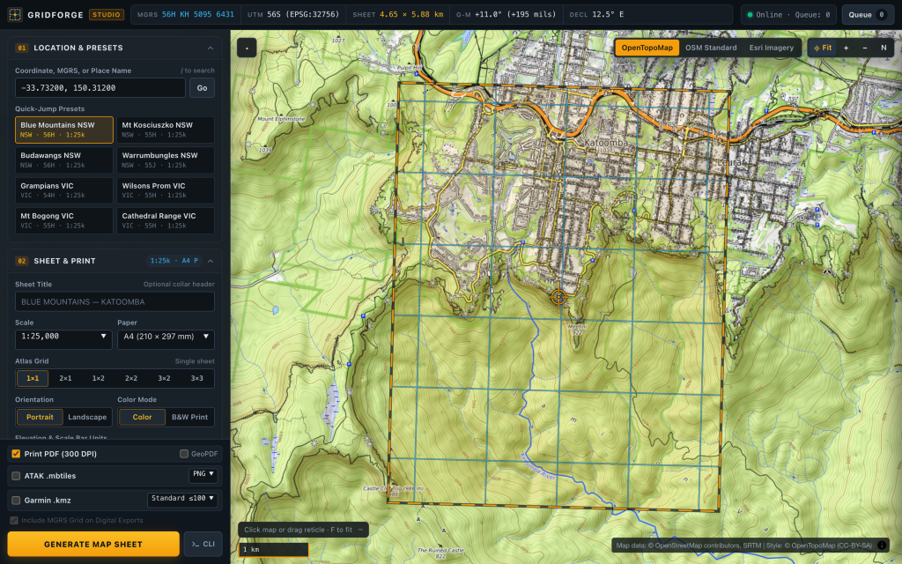
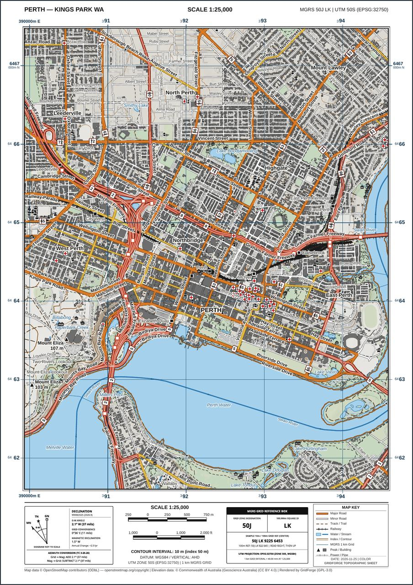

<div align="center">

# GridForge

**Open-source, self-hostable military-style MGRS topographic map generator, print studio & offline device exporter.**

[](LICENSE)
[](pyproject.toml)
[](Dockerfile)
[](Dockerfile)
[](tests/)
[](docker-compose.yml)

True-scale **local UTM** 300 DPI print PDFs · **Multi-sheet Atlas PDFs** · **ATAK `.mbtiles`** · **Garmin Custom Maps `.kmz`** · **Air-gapped offline packs**

</div>

---



## What Makes GridForge Different

| Capability | GridForge | Typical Web Tile / Screenshot Tools |
| :--- | :--- | :--- |
| **True Protractor Scale (Local UTM)** | Projects every sheet into its native local **UTM zone (`EPSG:326xx`/`327xx`)** — straight, orthogonal 1 km MGRS grid squares verified within **≤ 0.02 mm** (0.000 mm skew) with a physical map protractor. | Renders Web Mercator (`EPSG:3857`) where scale distorts with latitude and grid squares warp. |
| **Zero Multi-TB Mirroring + Air-Gapped Parity** | Streams **GA 5 m LiDAR / SRTM** (Australia), **USGS 3DEP 1 m LiDAR / 10 m** (US), and **Copernicus GLO-30** (global) + OSM on demand via GDAL `/vsicurl/`, OR runs 100% offline from a compact `--pack` via the exact same GeoPackage pipeline. | Requires downloading and maintaining multi-terabyte Planet/DEM mirrors upfront. |
| **Dedicated Laser-Print B&W Theme** | Hand-crafted high-contrast monochrome QGIS theme (diagonal forest hatches, stippled scrub, crisp cased roads, bright hillshade) engineered for black-and-white laser printers. | Post-process grayscale desaturation turns green forest + brown contours into illegible gray mud. |
| **Print + ATAK + Garmin From One Spec** | Generates 300 DPI vector print PDFs (single sheets or edge-matched `2×2`/`3×3` Atlas PDFs), **ATAK `.mbtiles`** (MBTiles 1.3 TMS), and **Garmin `.kmz`** (upright WGS84 baseline JPEGs respecting 100/500 tile caps) from identical cartography. | Separate disconnected tools with mismatched styling, bounds, and grids. |
| **16 GB Laptop / Homelab Friendly** | Zero Redis, SQLite WAL queue, `~124 MiB` combined idle RAM (`web` `64 MiB` + `worker` `60 MiB`), and ephemeral single-concurrency PyQGIS subprocesses (`~395 MB` typical job peak RSS). | Heavy multi-service stacks that leak memory or OOM on consumer hardware. |
| **100% Open & Cleanly Licensed Data** | GPL-3.0 code using strictly OpenStreetMap (ODbL), Geoscience Australia / DCCEEW CAPAD (CC BY 4.0), Copernicus DEM, USGS 3DEP / FEMA / NHD / FAA / NOAA (Public Domain), and NOAA WMM2025. | Proprietary basemaps, API keys, or restrictive map-server terms. |

---

## Visual Map Gallery

Every sheet below was generated directly by GridForge at 300 DPI and verified automatically by [`tests/integration/verify_pdf.py`](tests/integration/verify_pdf.py) for physical MediaBox dimensions, 1 km MGRS grid orthogonality, and exact scale accuracy.

| **Blue Mountains NSW — 1:25,000 A4 Color** (`EPSG:32756 · 56H`) | **Cradle Mountain TAS — 1:25,000 A4 Laser B&W** (`EPSG:32755 · 55G`) | **Boulder / Flatirons CO — 1:24,000 Letter Color** (`EPSG:32613 · 13T`) |
| :---: | :---: | :---: |
|  |  |  |
| *Copernicus / GA DEM, indexed contours, multi-directional hillshade, MGRS grid & WMM2025 collar* | *Dedicated B&W laser-print theme + GA Hydrology + CAPAD National Park boundaries (`AHD`)* | *USGS 3DEP 1 m LiDAR (`NAVD88`) + FEMA NFHL flood zones + NHD streams + FAA obstacle towers* |

| **Sydney Harbour NSW — 1:25,000 A4 Color** (`EPSG:32756 · 56H`) | **Uluru / Kata Tjuta NT — 1:25,000 A4 Color** (`EPSG:32752 · 52J`) | **Perth / Kings Park WA — 1:25,000 A4 Color** (`EPSG:32750 · 50J`) |
| :---: | :---: | :---: |
|  |  |  |
| *Native GA 5 m LiDAR (`AHD`) dense urban harbour & North Shore terrain* | *Outback UTM `52S` · GA SRTM 1s (`AHD`) + Outback bores/waterpoints + CAPAD NPC/IPA + airfields* | *Native GA 5 m LiDAR (`AHD`) · Swan River coastal guard + westerly G-M declination (`2.1° W`)* |

### 300 DPI Vector Detail & TC 3-25.26 Military Print Collar


### Offline Field Device Exports — ATAK `.mbtiles` & Garmin Custom Maps `.kmz`


---

## 60-Second Self-Hosted Quickstart (`docker compose up`)

Run the full self-hosted **MapLibre GL JS Print Studio** and async render worker locally on Apple Silicon (`arm64`) or Linux (`amd64`):

```bash
git clone https://github.com/jremick/gridforge.git
cd gridforge
docker compose up --build -d
```

Open **<http://localhost:8080>** in your browser:

- **Place Search & Direct Coordinates:** Press `/` to search any place name (via built-in Nominatim proxy), paste `lat,lon`, enter an MGRS coordinate (e.g. `56H KH 5100 6400`), jump to curated **NSW & Victoria outdoor presets** (*Blue Mountains, Mt Kosciuszko, Budawangs, Warrumbungles, Grampians, Wilsons Promontory, Mt Bogong, Cathedral Range*), or drag the crosshair reticle anywhere on the map.
- **Live Tilted UTM Footprint & MGRS Preview:** Visually inspects the exact true-scale UTM paper frame and 1 km MGRS grid lines (including convergence tilt) in real time; press `F` to fit the sheet to view.
- **Multi-Sheet Edge-Matched Atlas PDFs:** Select `1×1`, `2×1`, `1×2`, `2×2`, `3×2`, or `3×3` in **Sheet & Print** to preview labeled adjacent sheets (`A1`–`C3`) sharing one locked UTM projection and export a merged multi-page true-scale Atlas PDF.
- **Custom Overlays & Offline Packs:** Drag and drop `.geojson`, `.gpx`, or `.csv` files (try [`examples/katoomba_route.geojson`](examples/katoomba_route.geojson)), toggle Australian/US federal overlays, or pick any air-gapped pack placed in `./packs/`.
- **Shareable Permalinks & Copy CLI:** Bookmark or share any map setup directly via URL parameters, click **Copy CLI** for the exact reproducible Docker command, and **Preview** or **Download** finished PDF / `.mbtiles` / `.kmz` artifacts from the Queue drawer.

Stop the stack cleanly anytime with `docker compose down`.

---

## CLI Cookbook & Air-Gapped Australia Pack Builder

Every studio capability is also available headlessly via the `gridforge` CLI (see [`examples/render-examples.sh`](examples/render-examples.sh) for a runnable end-to-end cookbook).

### Render a Print Sheet + Custom Route Overlay

```bash
mkdir -p out
docker run --rm -v "$(pwd)/out:/out" -v "$(pwd)/examples:/examples:ro" gridforge:dev \
  gridforge render \
    --center "-33.732,150.312" \
    --scale 25000 --paper a4 --mode color --units metric \
    --dem-source au-elvis \
    --overlay /examples/katoomba_route.geojson \
    --title "BLUE MOUNTAINS — KATOOMBA LOOP" \
    --output /out/katoomba_25k_a4_color.pdf \
    --mbtiles /out/katoomba_25k.mbtiles \
    --kmz /out/katoomba_25k.kmz
```

### Australia-Wide Cloud-Native Sheets (UTM `49S`–`56S`, `AHD`)

```bash
# Sydney Harbour — Native GA 5 m LiDAR (AHD)
docker run --rm -v "$(pwd)/out:/out" gridforge:dev \
  gridforge render --center "-33.8568,151.2153" --scale 25000 --paper a4 \
    --dem-source au-elvis --title "SYDNEY HARBOUR — NORTH SHORE" \
    --output /out/sydney_25k_a4_color.pdf

# Uluru / Kata Tjuta NT — Outback Bores, CAPAD National Parks/IPAs & Airfields
docker run --rm -v "$(pwd)/out:/out" gridforge:dev \
  gridforge render --center "-25.3444,131.0369" --scale 25000 --paper a4 \
    --dem-source au-elvis --au-overlay au-hydro --au-overlay au-parks --au-overlay au-aviation \
    --title "ULURU — KATA TJUTA NT" --output /out/uluru_25k_a4_color.pdf

# Cradle Mountain TAS — Dedicated Laser-Print B&W + ATAK + Garmin Exports
docker run --rm -v "$(pwd)/out:/out" gridforge:dev \
  gridforge render --center "-41.684,145.951" --scale 25000 --paper a4 --mode bw \
    --dem-source au-elvis --au-overlay au-hydro --au-overlay au-parks \
    --title "CRADLE MOUNTAIN — TASMANIA" \
    --output /out/cradle_mountain_25k_a4_bw.pdf \
    --mbtiles /out/cradle_mountain_25k.mbtiles --kmz /out/cradle_mountain_25k.kmz
```

### North America High-Res LiDAR + Federal Overlays (`NAVD88`)

```bash
docker run --rm -v "$(pwd)/out:/out" gridforge:dev \
  gridforge render --center "40.005,-105.285" --scale 24000 --paper letter --units imperial \
    --dem-source usgs3dep --us-overlay fema --us-overlay nhd --us-overlay towers \
    --title "BOULDER — FLATIRONS, CO" \
    --output /out/boulder_24k_letter_color.pdf \
    --mbtiles /out/boulder_24k.mbtiles --kmz /out/boulder_24k.kmz
```

### Air-Gapped Offline Packs (`gridforge pack`)

Build compact, self-contained regional packs streaming disk-to-disk at `< 300 MB` RAM across all 8 Australian states/territories (`act`, `tas`, `vic`, `nsw`, `sa`, `qld`, `nt`, `wa`), 7 curated tactical regions (`blue-mountains`, `sydney-basin`, `australian-alps`, `tasmania-wilderness`, `red-centre`, `perth-hills`, `far-north-qld`), or any custom `w,s,e,n` bounding box:

```bash
# List available Australian regions & estimated sizes
docker run --rm gridforge:dev gridforge pack list-regions

# Build a self-contained offline pack into ./packs/
mkdir -p packs
docker run --rm -v "$(pwd)/packs:/data/packs" gridforge:dev \
  gridforge pack build --region blue-mountains --output /data/packs/blue-mountains

# Render 100% air-gapped (zero network calls) using --pack
docker run --rm -v "$(pwd)/packs:/data/packs:ro" -v "$(pwd)/out:/out" gridforge:dev \
  gridforge render --center "-33.732,150.312" --scale 25000 --paper a4 \
    --pack /data/packs/blue-mountains --output /out/offline_sheet.pdf
```

Render and export require both elevation and OSM data. If you built a partial pack, supply the missing input with `--offline-dem` or `--offline-pbf`. Studio requires both inputs in the selected pack.

### Standalone Offline Device Exports (`gridforge export`)

```bash
docker run --rm -v "$(pwd)/out:/out" gridforge:dev \
  gridforge export --center "-33.732,150.312" --scale 25000 --paper a4 \
    --format both --mbtiles-format png --garmin-profile standard --no-grid \
    --output /out/katoomba_offline
```

- **ATAK (Android):** Copy `<map>.mbtiles` into `atak/imagery/` and select it in ATAK's Maps / Imagery menu (`--mbtiles-format png` for crisp topo linework or `jpg` for smaller archives).
- **Garmin Handhelds:** Copy `<map>.kmz` into `Garmin/CustomMaps/` (`--garmin-profile standard` = 100-tile cap for classic eTrex/GPSMAP/Oregon; `modern` = 500-tile cap for GPSMAP 66/67, Montana 700, Oregon 7xx; or `--max-tiles N`).

---

## Measured Performance & Memory Profile

Measured on an Apple Silicon **M5 (16 GB RAM)** host running native `linux/arm64` Docker (`debian:trixie-slim`, PyQGIS `3.40.6`, GDAL `3.10.3`):

| Metric | Measured Result | Guardrail / Target |
| :--- | :--- | :--- |
| **`web` container idle RAM (`docker stats`)** | **`64.2 MiB`** (`65.0 MiB` post-render) | `< 250 MB` (`512m` hard limit; zero `qgis` imports) |
| **`worker` container idle RAM (`docker stats`)** | **`59.5 MiB`** | `< 200 MB` (`3g` hard limit; concurrency `1`) |
| **Typical render job peak RSS (`peak_rss_mb`)** | **`394.6 MB`** (A4 PDF + Garmin KMZ) | `< 2.0 GB` (ephemeral `spawn` PyQGIS subprocess) |
| **Warm-cache A4 300 DPI render time** | **`2.25 s`** (Katoomba B&W) / **`5.92 s`** (Boulder 1 m LiDAR) | Fast interactive turnaround |
| **1 km MGRS physical grid accuracy** | **`0.0046 mm`** (Letter 1:24k) / **`0.0185 mm`** (A4 1:25k) | `≤ 0.15 mm` protractor tolerance |
| **MGRS grid orthogonality skew** | **`0.0000 mm`** across all tested UTM zones | `< 0.05 mm` |
| **Automated test suite (`pytest`)** | **`171+` offline unit & integration tests passing** | Runs offline inside `gridforge:dev` |

---

## Architecture & Testing

```text
src/gridforge/
├── config.py              # Pydantic v2 SheetSpec, CartoOptions, PackManifest, ExportResult contracts
├── cli.py                 # Typer CLI (`render`, `export`, `inspect`, `pack`, `serve`)
├── geo/                   # UTM/MGRS CRS, 1 km/100 km grid generator, WMM2025 declination SVGs
├── sources/               # GA 5m/SRTM (AU), USGS 3DEP (US), Copernicus GLO-30, Overpass, PBF, AU/US/user overlays
├── packs/                 # Memory-safe streaming Australia offline pack catalog & builder (< 300 MB RAM)
├── pipeline/              # OSM -> GeoPackage normalization, GDAL terrain/hillshade/contours, job runner
├── render/                # Isolated PyQGIS subprocess worker, Color/B&W styling, QgsPrintLayout collar
├── export/                # Collarless UTM GeoTIFF renderer, ATAK MBTiles 1.3, Garmin Custom Maps KMZ
└── web/                   # FastAPI server (zero qgis imports), SQLite WAL queue, geocode proxy, atlas worker
web/                       # TypeScript + Vite + MapLibre GL JS self-hosted tactical print studio SPA
config/osmconf.ini         # Shared GDAL OSM driver schema for online & air-gapped parity
assets/
├── icons/                 # 18 crisp self-contained military/topo/Outback SVG symbols
└── styles/{color,bw}/     # 62 native QGIS 3.40 Color & dedicated laser-print B&W .qml styles
examples/                  # Sample Blue Mountains GeoJSON route overlay & runnable CLI cookbook
```

```bash
# Offline unit + integration CI gate (no network required)
docker run --rm -v "$(pwd):/app" gridforge:dev pytest tests/unit tests/integration

# Live multi-region Australia & North America E2E tests
docker run --rm -e GRIDFORGE_RUN_LIVE=1 -v "$(pwd):/app" gridforge:dev pytest tests/integration -m live
```

---

## Roadmap & Backlog

- **`v1.1` (In Progress):** High-resolution **NSW & Victoria state trail, fire-trail, hut, campground & trig station** layers (CC BY 4.0 NSW Spatial Services / NPWS & Vicmap / DEECA), interactive route & waypoint planning tools, and corridor / multi-sheet print enhancements.
- **Backlog:** **Air-Gapped Web Basemap Mode** (self-hosted local PMTiles/MBTiles basemap option in the MapLibre Studio UI for fully disconnected deployments), additional regional LiDAR providers, and batch/corridor strip-map generation.

---

## Data Sources, Attributions & License

| Dataset / Component | Scope & Vertical Datum | License & Attribution |
| :--- | :--- | :--- |
| **GridForge Source Code** | Application, styles, icons, web studio | **GNU GPL v3.0 or later** ([LICENSE](LICENSE)) |
| **OpenStreetMap** | Global roads, trails, rail, water, buildings, landcover, POIs | **ODbL** — Map data © OpenStreetMap contributors (`openstreetmap.org/copyright`) |
| **Geoscience Australia / DEA** | Australia 5 m LiDAR (2025) & SRTM 1s (`AHD`), Surface Hydrology, Electricity/Pipelines, Aviation/Homesteads | **CC BY 4.0** — © Commonwealth of Australia (Geoscience Australia / Digital Earth Australia) |
| **DCCEEW CAPAD 2025** | Australia National Parks, Nature Reserves, IPAs | **CC BY 4.0** — © Commonwealth of Australia (DCCEEW) |
| **Copernicus WorldDEM-30** | Global 30 m elevation (`EGM2008`) | **Copernicus DEM License** — © DLR e.V. 2010–2014 & © Airbus Defence and Space GmbH 2014–2018, EU & ESA |
| **USGS 3DEP / NHD / FEMA / FAA / NOAA** | US 1 m & 10 m DEM (`NAVD88`), NHD streams, NFHL flood zones, DOF obstacle towers, ENC charts | **US Public Domain** |
| **NOAA / NCEI WMM2025** | Global magnetic declination & secular variation (`2025.0–2030.0`) | **US Public Domain** |
