# GridForge Visual Gallery

Every sheet below was rendered directly by GridForge at 300–600 DPI in native local UTM and verified by [`tests/integration/verify_pdf.py`](../tests/integration/verify_pdf.py) for exact MediaBox dimensions, 1 km MGRS orthogonality, and protractor scale accuracy.

## Print Studio

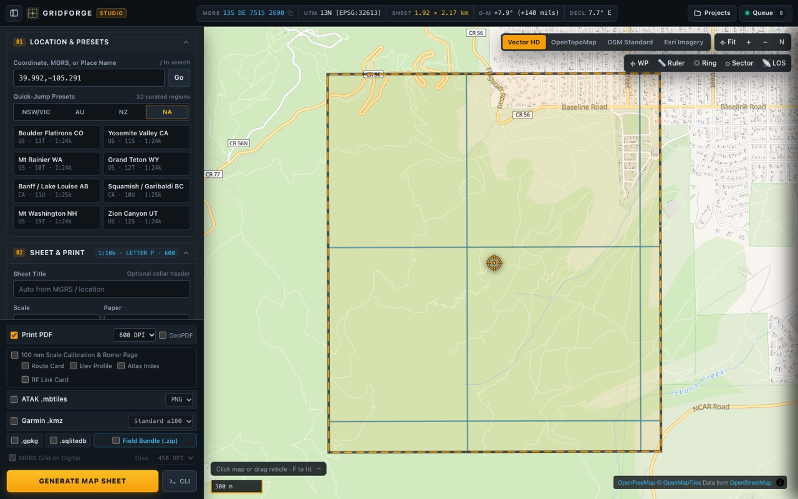

## Multi-Continent Themes, RF Fresnel Cards, Viewsheds & Atlas Covers

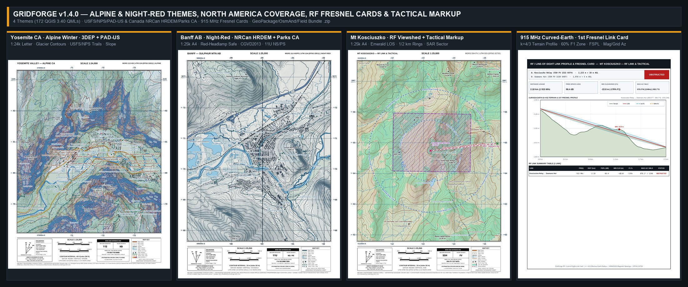

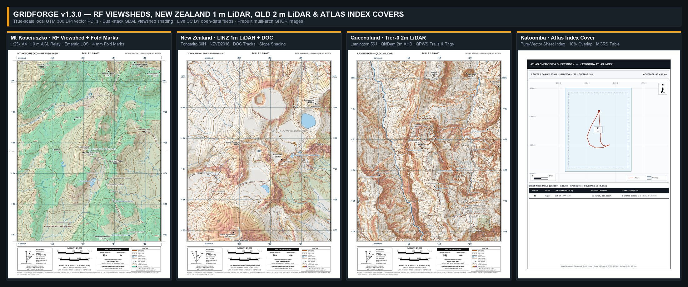

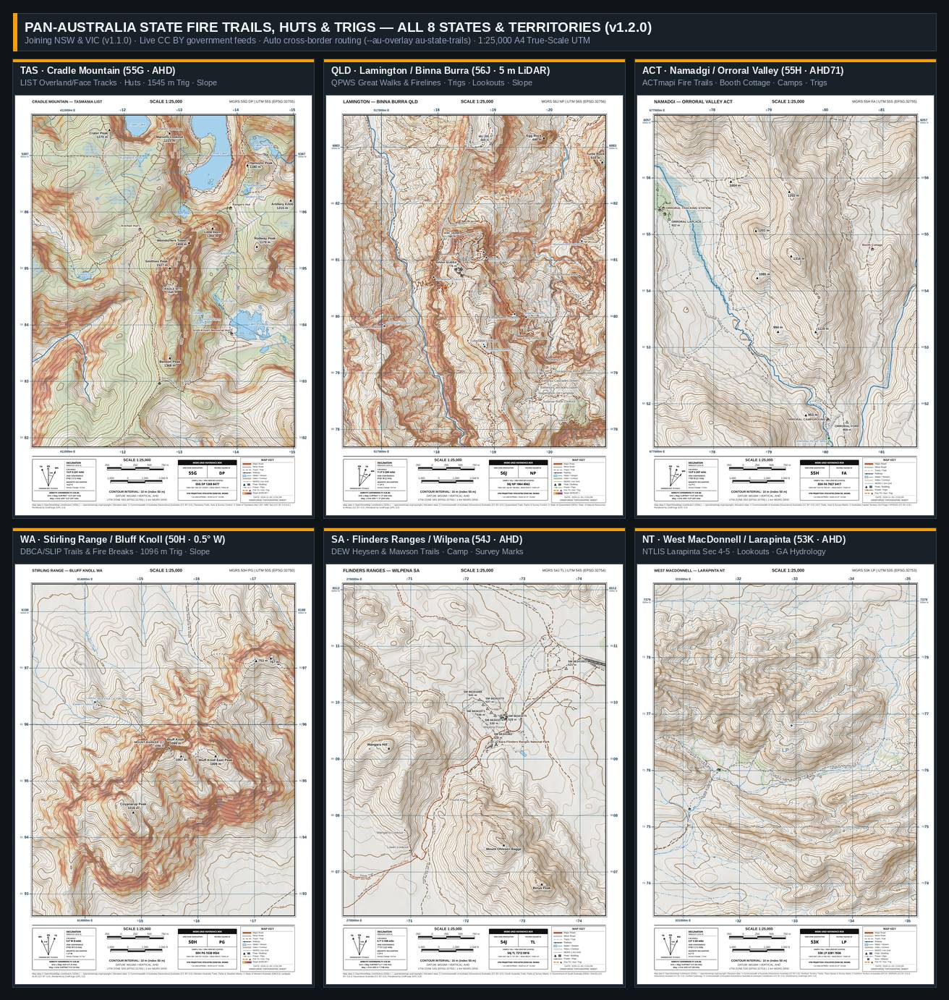

## Regional Sheets

| **Blue Mountains NSW — 1:25,000 A4 Color** (`56H`) | **Cradle Mountain TAS — 1:25,000 A4 Laser B&W** (`55G`) | **Boulder / Flatirons CO — 1:24,000 Letter Color** (`13T`) |
| :---: | :---: | :---: |
| 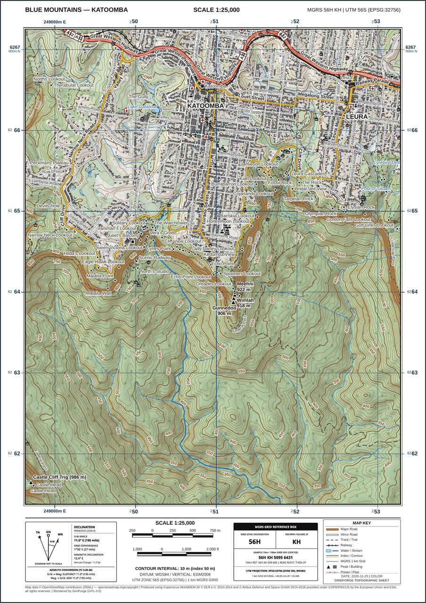 | 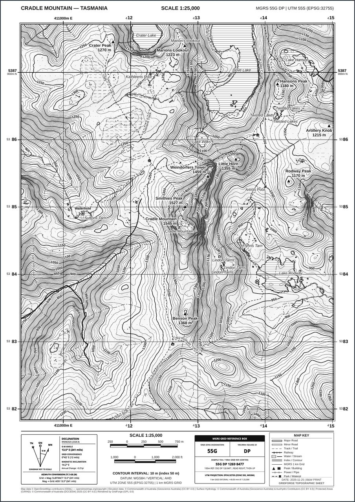 | 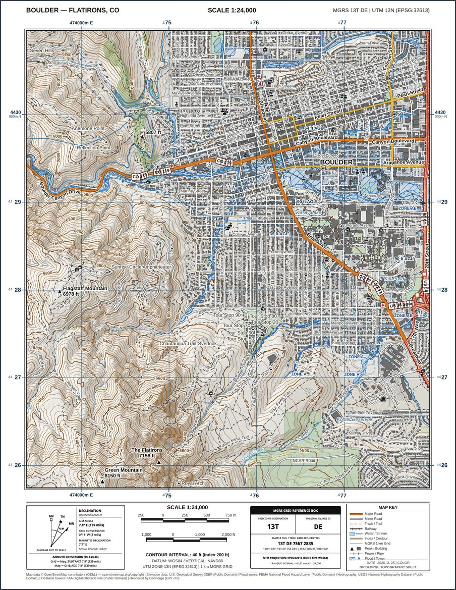 |
| *Indexed contours, multi-directional hillshade, MGRS grid & WMM2025 collar* | *Dedicated B&W laser-print theme + GA Hydrology + CAPAD boundaries (`AHD`)* | *USGS 3DEP 1 m LiDAR (`NAVD88`) + FEMA NFHL + NHD + FAA obstacle towers* |

| **Sydney Harbour NSW — 5 m LiDAR** (`56H`) | **Uluru / Kata Tjuta NT — Outback** (`52J`) | **Perth / Kings Park WA — 5 m LiDAR** (`50J`) |
| :---: | :---: | :---: |
| 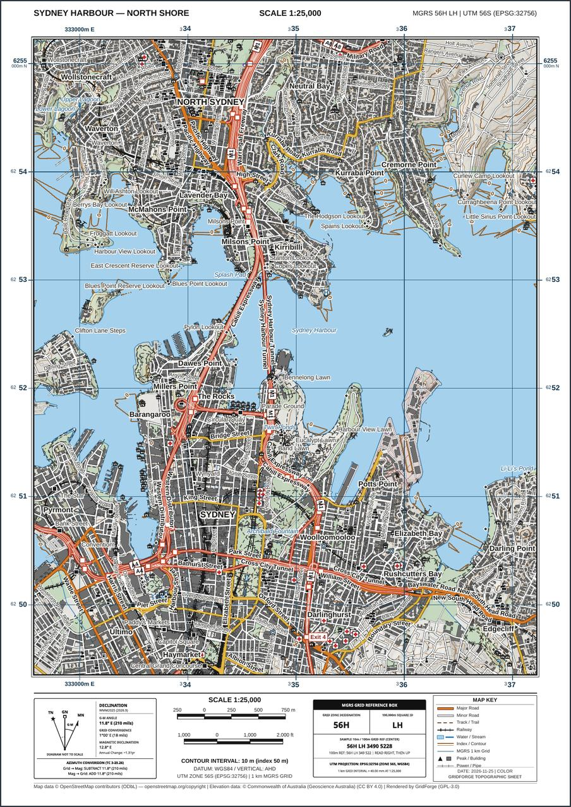 | 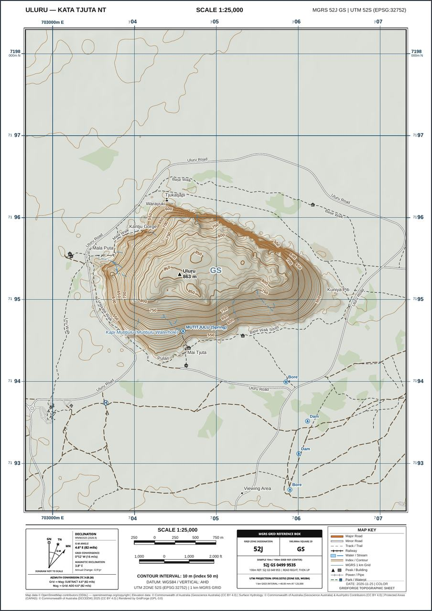 | 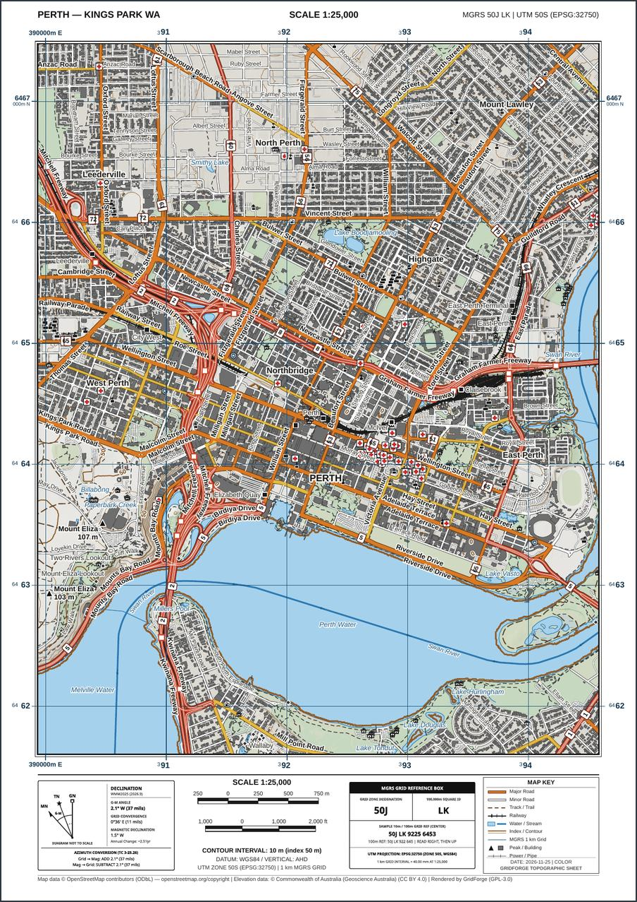 |
| *Native GA 5 m LiDAR (`AHD`) dense urban harbour & North Shore terrain* | *Outback UTM `52S` · GA SRTM 1s + Outback bores + CAPAD + airfields* | *Native GA 5 m LiDAR (`AHD`) · Swan River coastal guard + `2.1° W` G-M* |

## Collar Detail, Field Supplements & Offline Device Exports

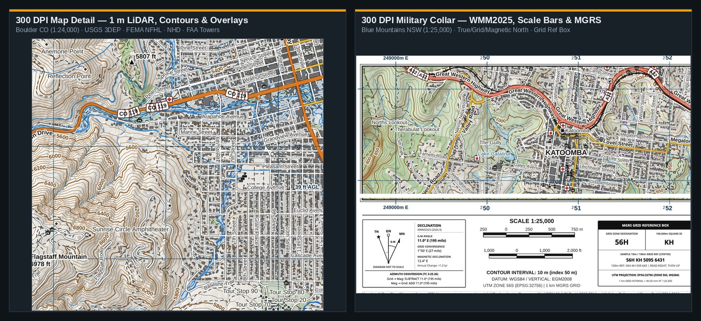

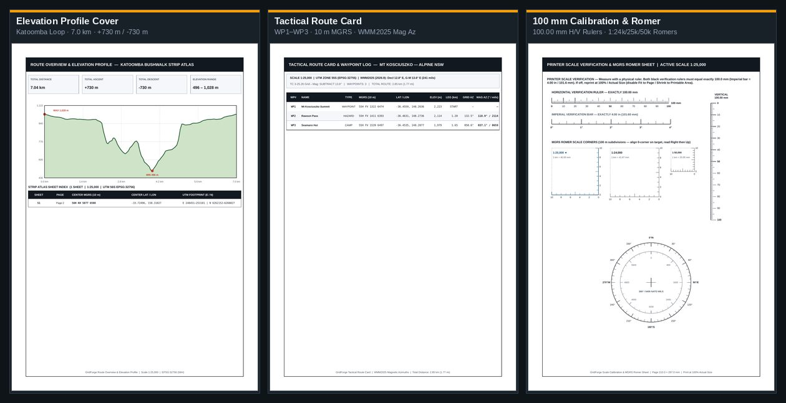

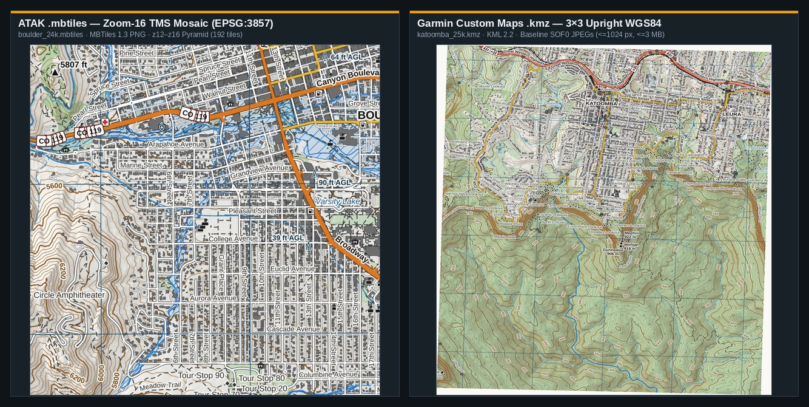
